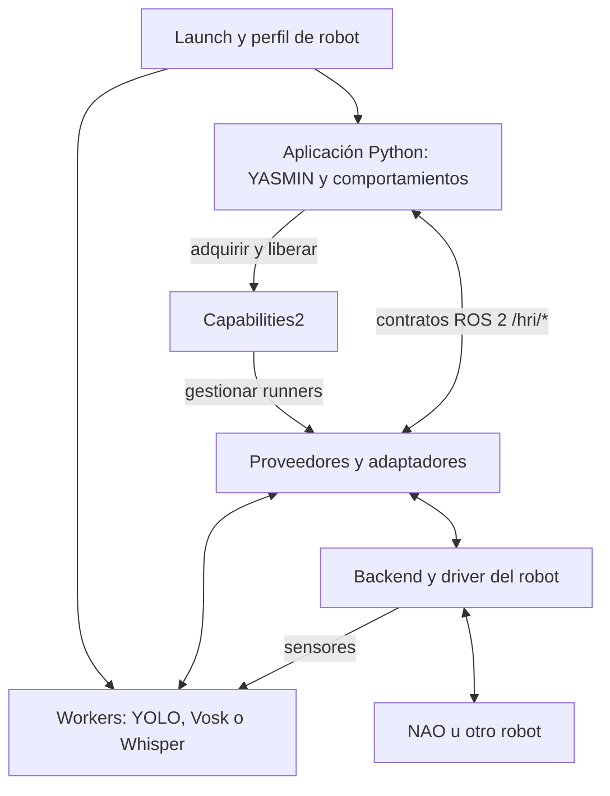

# Contexto del proyecto de grado para agentes de IA

**Fecha de revisión: 17 de noviembre de 2026.** Este documento describe el código local y las evidencias disponibles en esa fecha. No significa que todos esos cambios estén publicados en GitHub.

> **Instrucción principal:** antes de proponer o aplicar cambios, entiende y conserva la arquitectura del proyecto: aplicación y comportamientos con YASMIN, contratos portables de capacidades, gestión de proveedores con Capabilities2 y adaptadores que encapsulan cada backend. Resolver un problema de NAO no debe convertir la aplicación en código exclusivo de NAO.

Este archivo es una guía de contexto para leer explícitamente; su nombre no hace que todas las herramientas de IA lo carguen automáticamente. Las instrucciones posteriores y explícitas del usuario prevalecen sobre las preferencias históricas aquí registradas.

## 1. Qué estamos construyendo y en qué etapa estamos

El proyecto desarrolla una **aplicación HRI modular y portable sobre ROS 2**. La intención es reutilizar los comportamientos de alto nivel entre robots, sustituyendo perfiles de configuración y proveedores de capacidades, en lugar de reescribir la lógica de interacción para cada robot.

La base funcional incluye:

- `DetectPeople`: entregar detecciones de personas mediante un contrato común.
- `MoveVelocity`: movimiento continuo y parada, utilizado por el seguimiento.
- `MoveRelative`: desplazamientos relativos acotados; es una capacidad distinta del movimiento del seguimiento.
- `Speak`: hacer que el robot pronuncie un texto.
- `TranscribeSpeech`: recibir resultados de reconocimiento de voz mediante un contrato común, con proveedores Whisper y Vosk.
- `OrientCamera`: orientación opcional de cámara/cabeza, actualmente desactivada en el flujo habitual de seguimiento.
- `FollowPerson`: comportamiento que compone principalmente `DetectPeople + MoveVelocity`, con voz y habla opcionales.

**La etapa actual es de cierre funcional, ajuste de errores y consolidación de evidencias**, no de reconstrucción de la arquitectura. Ya se ejecutaron pruebas físicas y el usuario confirmó movimiento, seguimiento y respuestas de voz en distintas sesiones. Sin embargo, las últimas pruebas presentan problemas de disponibilidad y continuidad de imagen/audio; no se debe describir la integración completa como validada de forma definitiva.

La propuesta original contemplaba **NAO y Pepper**. El usuario informó el 11 de noviembre que Pepper sufrió un accidente y no está operativo; no se conoce la fecha exacta del accidente. Las pruebas físicas actuales se realizan **solo con NAO**. Se conservan las evidencias anteriores de Pepper, pero no prueban que la aplicación integrada actual esté validada allí. Tampoco hay constancia aquí de una modificación formal de los objetivos académicos aprobados.

El usuario quiere presentar una aplicación que se ejecute con un comando sencillo, manteniendo módulos separados. El punto de entrada actual es:

```bash
ros2 launch hri_reference_app aplicacion_hri.launch.py
```

Este launch compone los procesos necesarios de la aplicación. **El driver del robot se inicia aparte** con el procedimiento habitual del usuario.

## 2. Reglas de trabajo que no se deben perder

1. **Modificar únicamente lo que está dentro de `~/Documents/portable_hri_ws`.** El usuario rechazó expresamente cambios en el bringup/driver de NAOqi o SinfonIA. Mantener su comando `bash launch_driver.sh`. Leer código externo para comprender un fallo no autoriza a editarlo ni a reconfigurar el robot.
2. **Conservar la separación de arquitectura descrita en este documento.** No solucionar un fallo saltándose los contratos, Capabilities2 o las comprobaciones de parada.
3. **Mantener el algoritmo propio de seguimiento.** `ejemplo.py`, ubicado en la raíz del workspace, es una referencia de otro proyecto basada en ROS 1. Se revisó y el usuario decidió no sustituir su algoritmo por ese código.
4. **Preservar el trabajo local existente.** Hay modificaciones y archivos nuevos sin commit. Antes de editar, revisar `git status` en cada repositorio afectado. No hacer `reset`, `clean`, restauraciones masivas ni sobrescribir trabajo ajeno.
5. **No hacer commit o push por iniciativa propia.** El usuario excluyó expresamente `EJECUTAR_HRI_NAO.md` de los commits; mantener esa exclusión salvo una nueva instrucción.
6. **Las pruebas físicas las realiza el usuario.** No iniciar movimiento, captura de micrófono, cambios de postura, rigidez, autonomía o distancias de seguridad como parte de una comprobación automática. Tampoco cambiar red, IP o Wi-Fi para probar una hipótesis sin una instrucción específica.
7. **Terminal tranquila por defecto:** sin transcripciones ni muestras de seguimiento continuas, sin salida de depuración de YOLO y sin saludo inicial. Los diagnósticos detallados van a archivos.
8. **Sin activación por toque de cabeza.** La escucha se activa dentro del flujo de la aplicación, con la configuración correspondiente.
9. **No ampliar el alcance sin necesidad.** OpenAI, Ollama y respuestas generativas se discutieron como posibilidades futuras; no forman parte de la integración actual. Los comandos actuales utilizan reglas y respuestas predefinidas.
10. **Separar hechos, hipótesis y validaciones pendientes.** Una prueba unitaria, un backend simulado, la aceptación de una orden y una observación física del robot son evidencias diferentes.

No convertir este documento en una restricción inmutable: si el usuario solicita después un cambio de alcance o arquitectura, explicar su impacto y actualizar el contexto de forma explícita.

## 3. Arquitectura que debe respetarse

### 3.1 Responsabilidades

| Capa | Responsabilidad | No le corresponde |
| --- | --- | --- |
| Launch y perfiles | Seleccionar robot, proveedores, modelos, tópicos de backend y parámetros; iniciar procesos y validar configuración. | Implementar el control de seguimiento o la interpretación de comandos. |
| Aplicación y comportamientos, con YASMIN | Decidir qué hacer y cuándo; coordinar seguimiento, pausas, voz, habla y liberación de recursos. | Llamar directamente a NAOqi o a un motor de inferencia. |
| Contratos de capacidades | Definir servicios, mensajes, unidades, estados, identificación de proveedor y semántica temporal. | Contener decisiones específicas de un robot. |
| Capabilities2 | Registrar/seleccionar proveedores, adquirir y liberar capacidades, gestionar runners y vínculo con el cliente. | Detectar personas, reconocer voz o calcular velocidades de seguimiento. |
| Proveedores y workers | Adaptar contratos al hardware/backend; ejecutar inferencia o transporte específico. | Decidir por su cuenta que una frase debe poner al robot a caminar. |
| Driver y robot | Transportar sensores y ejecutar las órdenes específicas del dispositivo. | Absorber la lógica portable de la aplicación HRI. |



El diagrama representa responsabilidades, no una cola única de mensajes. **Los datos de percepción y las velocidades no pasan todos por el servidor Capabilities2**: se intercambian por los tópicos/servicios de sus contratos. Capabilities2 gestiona el uso y ciclo de vida de los proveedores. La composición también puede iniciar workers antes de adquirir una capacidad.

Los proveedores actuales emplean principalmente runners C++ derivados de `RunnerBase`, registrados con `pluginlib`. La aplicación y buena parte de los workers están implementados en Python.

### 3.2 Límites concretos para cualquier modificación

- `FollowPerson` debe consumir detecciones portables y producir propuestas de movimiento; no importar `yolo_msgs` ni conocer el SDK de NAOqi.
- `follow_controller.py` mantiene el cálculo de control independiente de ROS y del hardware. `follow_session.py` coordina recepción, tiempos, recuperación y ejecución.
- El movimiento se envía por `/hri/cmd_vel` tras adquirir `MoveVelocity`. **No publicar directamente en `/nao/cmd_vel` desde el comportamiento** ni eludir el watchdog del proveedor.
- El habla se solicita mediante `Speak` en `/hri/speak`. **No usar `/nao/say` directamente desde la lógica de interacción.**
- Vosk y Whisper entregan resultados de reconocimiento. La interpretación de «detente» o «sígueme» pertenece a la aplicación, no al worker ni al proveedor ASR.
- Los perfiles, launch, adaptadores y observadores de diagnóstico sí pueden conocer nombres concretos de backend. Por ejemplo, el diagnóstico puede observar `/yolo/detections`; eso no autoriza a acoplar el controlador a `yolo_msgs`.
- Preservar sellos temporales originales, identidad del proveedor, validación de datos y unidades. **No rejuvenecer imágenes antiguas asignándoles la hora actual**, mantener una velocidad antigua indefinidamente ni quitar comprobaciones para que el robot «por fin camine».
- Un cambio de contrato obliga a revisar productores, consumidores, pruebas y compilación de dependientes. No cambiar silenciosamente unidades o significado de campos.
- Una reutilización del proveedor NAOqi entre NAO y Pepper mediante remapeos es válida cuando las APIs y la semántica coinciden. No duplicar proveedores solo por el nombre del robot.
- Que YOLO y ASR sean procesos distintos no evita que compartan y compitan por la misma CPU.

### 3.3 Dónde corresponde implementar un cambio

| Cambio solicitado | Lugar principal |
| --- | --- |
| Afinar avance/giro o la tolerancia de centrado | Controlador puro y sus pruebas; exponer configuración si se necesita, conservando límites. |
| Esperar/reanudar tras pérdida de persona o imagen | Sesión/comportamiento de seguimiento, con parada y comprobaciones de recuperación. |
| Agregar sinónimos y respuestas a comandos | Configuración de voz y política de interpretación de la aplicación. |
| Cambiar Vosk por Whisper u otro motor | Selección en composición y proveedor/worker compatible con `TranscribeSpeech`. |
| Cambiar tópico de cámara, modelo o robot | Perfil y remapeos, verificando geometría, tiempos y compatibilidad. |
| Adaptar una base con ruedas | Proveedor de movimiento y perfil; conservar el contrato y revisar sus límites/semántica. |
| Observar latencia o causas de parada | Diagnósticos pasivos; no introducir control del robot en el observador. |
| Resolver un fallo dentro del driver externo | Diagnosticar y comunicar el límite de alcance; no editar ese workspace. |

## 4. Repositorios y orden de lectura

El workspace no debe tratarse como un único repositorio Git. Revisar el repositorio concreto antes de usar comandos de Git.

| Repositorio | Ubicación local | Función |
| --- | --- | --- |
| [portable-hri-interfaces](https://github.com/jumafe1/portable-hri-interfaces) | `src/portable-hri-interfaces` | Contratos ROS 2 y definiciones de capacidades. |
| [portable-hri-providers](https://github.com/jumafe1/portable-hri-providers) | `src/portable-hri-providers` | Proveedores NAOqi, YOLO, Whisper, Vosk y puente compartido de voz. |
| [portable-hri-reference-system](https://github.com/jumafe1/portable-hri-reference-system) | `src/portable-hri-reference-system` | Aplicación, perfiles, launch, pruebas, resultados y este documento. |
| [portable-hri-docs](https://github.com/jumafe1/portable-hri-docs) | `src/portable-hri-docs`, clonado el 17 de noviembre | Documentación del proyecto de grado. Cada nota de `tesis/03 Pruebas` registra una prueba; actualizarla o crear otra cuando el usuario lo pida. |
| Dependencias externas | `src/capabilities2`, `src/naoqi_utilities_msgs`, `src/yolo_ros` | Infraestructura y backends; no confundirlos con los repositorios propios. |

**Orden recomendado para un agente nuevo:**

1. Leer este documento, sobre todo las reglas y responsabilidades.
2. Leer el alcance académico en [Proyecto.md](https://github.com/jumafe1/portable-hri-docs/blob/main/tesis/01%20Proyecto/Proyecto.md) y el diseño en [Semana 6 - Capacidades y servicios.md](https://github.com/jumafe1/portable-hri-docs/blob/main/tesis/01%20Proyecto/Semana%206%20-%20Capacidades%20y%20servicios.md).
3. Leer [APLICACION_HRI.md](APLICACION_HRI.md), el [perfil NAO](hri_reference_app/config/nao.yaml) y el [launch integrado](hri_reference_app/launch/aplicacion_hri.launch.py).
4. Revisar los contratos en `../portable-hri-interfaces/hri_capability_interfaces` y los proveedores implicados en `../portable-hri-providers`.
5. Seguir la ruta de código del comportamiento que se vaya a cambiar, según el mapa siguiente.
6. Leer las pruebas y resultados relacionados antes de diagnosticar o editar.

La documentación de tesis se organiza en `tesis/01 Proyecto` —alcance—, `tesis/02 Entorno` —entorno— y `tesis/03 Pruebas` —evidencias—. La revisión de este documento consultó su `main` en el commit `7f70ea3b009472681ca3da63bf803b1e4af2a1b2`; los enlaces a `main` pueden evolucionar.

Referencias de evidencia: [Semana 7 - Verificación NAO](https://github.com/jumafe1/portable-hri-docs/blob/main/tesis/03%20Pruebas/Semana%207%20-%20Verificaci%C3%B3n%20NAO.md) y [Seguimiento NAO - pruebas con y sin Whisper](https://github.com/jumafe1/portable-hri-docs/blob/main/tesis/03%20Pruebas/Seguimiento%20NAO%20-%20pruebas%20con%20y%20sin%20Whisper.md).

**Precaución documental:** hay secciones históricas que dicen que no existen comandos por voz o que el launch no inicia YOLO. No describen necesariamente el estado integrado actual. Contrastar fecha, modo y código: `hri_app.launch.py` es el launch de menor nivel; `aplicacion_hri.launch.py` es el punto de entrada integrado. No borrar la historia, pero no usarla como descripción del presente.

La guía local `EJECUTAR_HRI_NAO.md` también requiere cuidado: con el backend actual por defecto, un comando antiguo que solo active `transcribe_speech` puede iniciar **Vosk**, aunque la sección se llame «con Whisper». Para Whisper, seleccionar el backend explícitamente.

### Mapa de archivos de la aplicación

Todas estas rutas son relativas a `portable-hri-reference-system`:

| Archivo | Qué leer allí |
| --- | --- |
| [scripts/hri_app.py](hri_reference_app/scripts/hri_app.py) | Entrada y selección de modo de aplicación. |
| [scripts/follow_mode.py](hri_reference_app/scripts/follow_mode.py) | Máquina YASMIN, argumentos y cierre del modo de seguimiento. |
| [scripts/capability_lifecycle.py](hri_reference_app/scripts/capability_lifecycle.py) | Adquisición, vínculo/heartbeat y liberación de capacidades. |
| [scripts/follow_controller.py](hri_reference_app/scripts/follow_controller.py) | Validación geométrica y cálculo puro de propuestas de seguimiento. |
| [scripts/follow_session.py](hri_reference_app/scripts/follow_session.py) | Recepción ROS, antigüedad de observaciones, pausas y recuperación. |
| [scripts/follow_motion.py](hri_reference_app/scripts/follow_motion.py) | Transporte portable de velocidades, estados y confirmación de parada. |
| [scripts/follow_speech.py](hri_reference_app/scripts/follow_speech.py) | Sesión ASR asíncrona y manejo de disponibilidad de transcripción. |
| [scripts/voice_command_policy.py](hri_reference_app/scripts/voice_command_policy.py) | Normalización y reconocimiento de frases permitidas. |
| [scripts/voice_commands.py](hri_reference_app/scripts/voice_commands.py) | Pausa persistente, respuesta con Speak, protección frente al eco y reanudación. |
| [config/voice_commands.yaml](hri_reference_app/config/voice_commands.yaml) | Frases, respuestas y parámetros de voz. |
| [scripts/startup_speak.py](hri_reference_app/scripts/startup_speak.py) | Soporte de Speak y saludo opcional; el saludo está desactivado por defecto. |
| [scripts/follow_camera.py](hri_reference_app/scripts/follow_camera.py) | Orientación opcional de cámara, actualmente fuera del flujo habitual. |
| [scripts/hri_diagnostics.py](hri_reference_app/scripts/hri_diagnostics.py) | Registro pasivo de tiempos, estados y carga de CPU. |

En proveedores, revisar los YAML de `capability_providers`, los runners C++ y su registro de plugins. El puente común actual de ASR está en `hri_speech_providers/include/hri_speech_providers/transcribe_runner.hpp`; los workers están en `hri_whisper_providers/scripts` y `hri_vosk_providers/scripts`. No implementar dos veces la misma gestión de sesiones cuando corresponde al puente compartido.

## 5. Contratos y significado de los datos

| Capacidad | Interfaz portable principal | Semántica que conservar |
| --- | --- | --- |
| `Speak` | `/hri/speak`, servicio `Speak` | Texto/idioma y resultado identificado por proveedor. NAOqi adapta al backend de habla. |
| `DetectPeople` | `/hri/people`, `PersonDetection2DArray`; servicio `/hri/detect_people` | Cabecera de imagen origen, proveedor y cajas 2D en píxeles con confianza. Lista vacía y ausencia de mensajes son situaciones distintas. |
| `MoveVelocity` | `/hri/cmd_vel`, `geometry_msgs/msg/Twist`; `/hri/move_velocity/status` | Velocidades del cuerpo en m/s y rad/s; parada y estados del proveedor. No equivale a verificación física del desplazamiento. |
| `MoveRelative` | `/hri/move_relative`, servicio `MoveRelative` | Desplazamiento relativo en metros/radianes y resultado contrastado con odometría. No es el backend usado por FollowPerson. |
| `TranscribeSpeech` | `/hri/speech/transcribe`; `/hri/speech/transcript`; `/hri/speech/capture_status` | Admisión de solicitud, resultados asíncronos asociados a `request_id`, proveedor y segmentos; estado de captura separado del texto. |
| `OrientCamera` | `/hri/camera/orient`; `/hri/camera/orientation` | Solicitud y orientación medida. Los ángulos relativos al neutro no sustituyen una calibración extrínseca de cámara. |

En voz, `SpeechTranscript` distingue segmentos y cierre de sesión con `segment_index` y `final`. **No interpretar cualquier `final=false` como texto parcial de un reconocedor:** en el contrato de transmisión continua puede ser un segmento terminado dentro de una sesión que sigue abierta. Consultar los `.msg` y el productor antes de cambiar esta lógica.

Los workers de voz respetan activación/autorización de captura, asociación de solicitudes y vigencia de sesión. Que un proveedor esté registrado o adquirido no demuestra por sí mismo que llegan muestras de micrófono.

`MoveVelocity` incluye un watchdog de aproximadamente **300 ms** y exclusión con `MoveRelative` en el proveedor actual. No eliminar esos mecanismos. Los límites del proveedor y del comportamiento se aplican en capas distintas; para FollowPerson el movimiento lateral es cero y el giro está acotado a ±0,1 rad/s.

## 6. Configuración y comportamiento actuales

### 6.1 Perfil y punto de entrada

El archivo principal de configuración es [hri_reference_app/config/nao.yaml](hri_reference_app/config/nao.yaml). Los argumentos del launch permiten sobrescribir valores; no todo parámetro del controlador está expuesto todavía en YAML.

| Ajuste | Estado actual |
| --- | --- |
| Robot de prueba | NAO; entorno de trabajo ROS 2 Jazzy sobre Ubuntu 24.04. |
| Imagen de cámara | 320 × 240; frame esperado `CameraTop_optical_frame`. |
| Entrada de YOLO | `/nao/camera/front/image_raw`. |
| Inferencia YOLO | `yolov8n.pt`, CPU, tamaño de inferencia 320 × 320. No confundirlo con la resolución original. |
| Suscripción de imagen YOLO | `image_reliability: 2`, BEST_EFFORT, con cola KEEP_LAST(1) existente. |
| Detecciones de backend | `/yolo/detections`, adaptadas a `/hri/people`. |
| Confianza mínima | 0,65. |
| Tamaño objetivo | Desde el 17 de noviembre: **ancho** de caja / ancho de imagen = 0,33 (`target_width_ratio`). Con `target_width_ratio: 0` vuelve a altura de caja / altura de imagen = 0,75. Es una referencia visual, no una distancia en metros. |
| Avance máximo | 0,10 m/s. |
| Voz por defecto | Vosk, español, comandos acotados; `voice_commands=true`. |
| Audio | `/nao/mic_stamped` y `/nao/mic_info`; formato configurado `naoqi_pcm_s16le`. |
| Modelos | Whisper `~/.cache/whisper/base.pt`; Vosk `models/vosk-model-small-es-0.42` dentro del workspace. |
| Entorno de Vosk | `.venvs/vosk/bin/python`, separado del entorno de Whisper. |
| Salida normal | `log_level=warn`, `print_transcript=false`, `yolo_debug=false`. |
| Saludo y orientación de cámara | Desactivados en el uso habitual. |

El perfil conserva el texto «Hola, vamos a interactuar.», pero **`greet=false` impide pronunciarlo**. Mantener ese comportamiento solicitado por el usuario.

En el launch integrado, `enable_motion=true` y `transcribe_speech=true` están configurados por defecto, junto con las confirmaciones `MOVER` y `ESCUCHAR`. **No asumir que el comando corto es una prueba sin movimiento o sin micrófono.** El launch de menor nivel tiene otros valores por defecto.

El integrado inicia YOLO cuando `start_yolo=true`, que es el valor habitual. No hace falta iniciar otro YOLO manualmente. `/yolo/dbg_image` es una salida de visualización opcional; no es la fuente de imágenes que requiere el seguimiento. La opción histórica `start_whisper_worker` también interviene en la composición del worker de voz; leer el launch antes de inferir su alcance por el nombre.

### 6.2 Seguimiento visual y ajuste de 24 a 60 píxeles

- Se requiere una persona elegible y varias observaciones distintas para adquirir/reanudar el seguimiento; la configuración actual utiliza **tres** observaciones.
- La antigüedad máxima de imagen utilizada por el controlador es **0,75 s**. La aplicación puede seguir ejecutándose mientras espera datos válidos.
- Si no hay persona, aparecen varias elegibles o la imagen se vuelve antigua, el comportamiento ordena detenerse y espera recuperación. No debe mantener una orden anterior de marcha.
- La recuperación de movimiento exige observaciones frescas y las condiciones de parada/espera de la sesión; no basta con recibir repetidamente la misma detección.
- La proximidad se estima por tamaño aparente de caja. En el perfil NAO se usa el ancho, porque la altura se satura contra el borde de la imagen cuando la persona todavía está lejos. Una caja cortada arriba/abajo se acepta en modo ancho; una cortada a izquierda/derecha sigue deteniendo avance y giro. No hay distancia métrica fiable en este modo.

El usuario pidió primero ampliar de **24 a 60 píxeles** la tolerancia para avanzar con una imagen de 320 píxeles de ancho, y el 17 de noviembre pidió que NAO **no deje de avanzar al corregir la dirección**, como en `ejemplo.py`. El código local implementa:

1. Hasta ±24 px: conserva la propuesta de avance calculada según tamaño aparente.
2. Entre ±24 y ±60 px: reduce progresivamente el avance hasta un tercio de esa propuesta.
3. Desde ±60 px: mantiene ese tercio (como máximo unos 0,033 m/s) mientras gira para recentrar.

La cercanía, la caja cortada a izquierda/derecha y las paradas por persona ausente, varias personas o imagen antigua siguen dejando el avance en cero. Esto **no significa avanzar siempre a velocidad máxima** dentro de la banda. Tampoco amplía a 60 px la zona sin giro: el giro tiene otra banda, actualmente de unos ±12,8 px a esa resolución. Los umbrales de avance se normalizan respecto al ancho de imagen.

Con el objetivo de ancho 0,33, el avance exige un ancho relativo inferior a 0,30; por encima de 0,36 se considera demasiado cerca para avanzar, aunque puede centrar mediante giro. La velocidad llega al máximo configurado cuando el ancho es 0,18 o menor. El valor depende del campo de visión horizontal de la cámara: **cada perfil de robot fija el suyo**, el controlador no contiene valores de NAO. En modo altura (`target_width_ratio: 0`) se conservan los umbrales anteriores: avance por debajo de 0,70 y demasiado cerca por encima de 0,80. Revisar el controlador para las condiciones completas de bordes y validez.

**Limitaciones:** no hay asociación robusta de identidad. Tras perder una persona y quedar una sola elegible, no se garantiza que sea la original. No hay navegación con mapa, evasión de obstáculos ni una demostración de seguridad basada en profundidad. No prometer que «solo termina con Ctrl+C»: fallos críticos de proveedor, contrato o ciclo de vida todavía pueden terminar la aplicación.

### 6.3 Órdenes de voz y respuestas

Con Vosk y comandos habilitados, el seguimiento **empieza pausado** (`start_paused=true`). La palabra de activación configurada es `nao`.

| Intención | Ejemplos de frases | Respuestas posibles |
| --- | --- | --- |
| Pausar | «Nao, detente», «Nao, para», «Nao, quédate quieto», «Nao, no me sigas», «Nao, no te muevas». | «Aquí me quedo», «De acuerdo, me detengo», «Me quedo quieto». |
| Seguir | «Nao, sígueme», «Nao, ven conmigo», «Nao, vuelve a seguirme». | «Te voy a seguir», «De acuerdo, voy contigo», «Vamos, te sigo». |

Las respuestas se seleccionan de un conjunto configurado. No interviene un modelo conversacional. El sistema normaliza y compara frases completas permitidas; no debe activar movimiento porque un texto arbitrario contenga la palabra «seguir».

La aplicación primero solicita parada y comprueba su confirmación, después habla mediante `Speak`. Para reanudar, espera el resultado correspondiente del habla, el margen contra eco —actualmente 1 s— y nuevas observaciones válidas. Una respuesta audible «Te voy a seguir» **no certifica** que ya existan condiciones visuales o de voz para moverse.

Una pausa ordenada por voz persiste aunque la persona vuelva a aparecer. La pérdida de disponibilidad de voz también puede mantener detenido el seguimiento cuando los comandos están habilitados. No eliminar ese bloqueo silenciosamente como solución a un fallo de micrófono.

## 7. Cómo preparar las terminales y ejecutar

Estos comandos son para el operador. Documentarlos o revisar el código **no autoriza al agente a ejecutarlos sobre el robot**.

### Terminal del driver: procedimiento existente

```bash
cd ~/Documents/naoqi/naoqi_ws
bash launch_driver.sh
```

No modificar ese script ni introducir otro perfil de bringup para hacer funcionar la aplicación.

### Terminal del workspace HRI

En una terminal nueva, cargar ROS, el underlay del driver y finalmente el overlay del proyecto:

```bash
cd ~/Documents/portable_hri_ws
source /opt/ros/jazzy/setup.bash
source ~/Documents/naoqi/naoqi_ws/install/setup.bash
source ~/Documents/portable_hri_ws/install/setup.bash
```

Si la preparación personal de la terminal depende de `.bashrc`, cargarla según el entorno del usuario. No editarla por defecto. No hace falta ejecutar actualizaciones de sistema ni recompilar todo antes de cada prueba.

**Aplicación actual con Vosk**, inicialmente pausada hasta una orden como «Nao, sígueme»:

```bash
ros2 launch hri_reference_app aplicacion_hri.launch.py record_diagnostics:=true
```

**Seguimiento sin voz**, con movimiento habilitado explícitamente:

```bash
ros2 launch hri_reference_app aplicacion_hri.launch.py \
  transcribe_speech:=false \
  enable_motion:=true confirm:=MOVER \
  record_diagnostics:=true
```

**Observación de seguimiento sin movimiento ni voz**, útil para aislar percepción:

```bash
ros2 launch hri_reference_app aplicacion_hri.launch.py \
  transcribe_speech:=false enable_motion:=false \
  record_diagnostics:=true
```

**Whisper explícito**, aquí en modo sin movimiento y sin interpretación de comandos:

```bash
ros2 launch hri_reference_app aplicacion_hri.launch.py \
  speech_backend:=whisper voice_commands:=false \
  enable_motion:=false record_diagnostics:=true
```

Para consultar argumentos: `ros2 launch hri_reference_app aplicacion_hri.launch.py --show-args`. Para observar texto deliberadamente: `ros2 topic echo /hri/speech/transcript --field text`. La configuración habitual evita imprimirlo.

Terminar primero la aplicación con Ctrl+C y después el driver cuando corresponda. Conservar los diagnósticos de la sesión antes de compararla con otra.

### Compilación y dependencias

En el workspace existente, si cambian interfaces, C++, instalación de archivos o paquetes, una compilación de los paquetes implicados puede ser:

```bash
colcon build --symlink-install --packages-select \
  hri_capability_interfaces hri_naoqi_providers hri_yolo_providers \
  hri_speech_providers hri_vosk_providers hri_whisper_providers \
  yolo_bringup hri_reference_app
source install/setup.bash
```

Esto presupone las dependencias del workspace ya preparadas; no es una receta completa para una máquina vacía. Seguir el manifiesto y las instrucciones del repositorio para una instalación nueva. Cambiar solo Python con instalación por enlaces puede requerir únicamente reiniciar el proceso, pero comprobar los enlaces reales antes de afirmarlo.

Vosk dispone de [scripts/setup_vosk.sh](scripts/setup_vosk.sh) para preparar su entorno/modelo cuando sea necesario. No descargar modelos durante cada arranque ni cambiar globalmente versiones de PyTorch u otras dependencias para probar una idea. Los modelos y entornos virtuales no son código para subir a Git.

## 8. Evidencias existentes y cómo interpretarlas

### 8.1 Lo comprobado antes de los fallos recientes

- Hay resultados históricos de `Speak` físico en NAO y Pepper: [NAO Speak](results/nao_speak_physical/result.json) y [Pepper Speak](results/pepper_speak_via_nao_provider_physical/result.json).
- Hay pruebas de `MoveRelative` con odometría y observación física: [NAO](results/nao_move_relative_physical/result.json), giro solicitado 0,1 rad y observado por odometría aproximadamente 0,0978 rad; [Pepper](results/pepper_move_relative_physical/result.json), avance solicitado 0,1 m y observado aproximadamente 0,1043 m. Son pruebas históricas de esas capacidades.
- El usuario confirmó movimiento real siguiendo una persona y recuperación tras perderla o detectar otra: salía de la vista, NAO paraba, volvía y continuaba; al pasar una segunda persona, paraba y después continuaba. Ver [recuperación de imagen](results/follow_image_recovery_20261104.json) y [espera de persona](results/follow_person_wait_20261104.json), distinguiendo pruebas de software de observaciones del usuario.
- Whisper produjo texto real, inicialmente con transcripciones pobres; se ajustó la segmentación/VAD. No existe aquí una evaluación formal de WER o precisión acústica.
- El usuario confirmó que Vosk reconoció comandos y NAO respondió, aunque debía hablar cerca. Eso es evidencia cualitativa inicial, no una evaluación formal de alcance o robustez.

### 8.2 Comparación con y sin Whisper, 4 de noviembre

La [comparación guardada](results/follow_whisper_comparison_20261104.json) recoge pruebas secuenciales, no un experimento controlado:

| Medida | Con Whisper | Sin Whisper |
| --- | --- | --- |
| Duración registrada | 103,8 s | 98,57 s |
| CPU media del sistema, excluyendo arranque | 92,82 % | 53,53 % |
| Detecciones recibidas | 229 | 498 |
| Frecuencia reciente de detecciones | 1,89 Hz | 5,01 Hz |
| Antigüedad de detección p95 reciente | 1,046 s | 0,201 s |
| Tiempo registrado esperando imagen fresca | 83,55 s | 0 s |

La CPU excluye los primeros 10 s; las medidas recientes de frecuencia/antigüedad corresponden a la ventana final de 30 s del registro. Los datos respaldan la hipótesis de competencia de recursos en esas sesiones. **No prueban que cualquier fallo posterior tenga esa causa**, ni aíslan por sí solos red, escena y carga de otros procesos.

La optimización adicional de Whisper quedó en espera por decisión del usuario. El worker ya contiene ajustes como límite de hilos de Torch, VAD y cola acotada; no proponerlos como si nunca se hubieran implementado. Se observaron descartes `speech_queue_full` cuando la inferencia no alcanzaba el ritmo de entrada.

### 8.3 Vosk y comparación de flujo, 11 de noviembre

El [resultado de Vosk](results/vosk_voice_commands_20261111.json) incluye pruebas de software y reconocimiento de audio sintético en español. Su `physical_success_verified:false` describe esa ejecución, no invalida la observación física posterior del usuario. Un intento de prueba ROS/DDS quedó bloqueado por el entorno antes de iniciar correctamente; no convertirlo en una validación de integración. La evaluación formal de Vosk sigue pendiente.

La [comparación del flujo de imágenes](results/follow_stream_qos_comparison_20261111.json) conserva resúmenes de:

- `/tmp/hri-stream-timing-b35_veds/result.json`: unas 53 imágenes en 30 s, aproximadamente 1,75 Hz; separación máxima 1,56 s y 11 huecos mayores de 0,75 s.
- `/tmp/hri-stream-timing-wychrzdz/result.json`: unas 73 imágenes en 30 s, aproximadamente 2,50 Hz; separación máxima 1,13 s y 5 huecos mayores de 0,75 s, después del cambio de QoS local.

La etapa observada entre cámara y YOLO rondó 0,10 s de mediana en ambos casos. La entrada seguía siendo irregular. Son sesiones secuenciales: **no atribuir toda la diferencia exclusivamente al QoS**. Los sellos de la cámara tampoco miden necesariamente todo el tiempo previo de adquisición/transporte desde el robot. Los archivos de `/tmp` son temporales; usar los resúmenes conservados cuando ya no existan.

El avance a un tercio mientras gira y el cambio a ancho de caja (0,33) disponen de comprobaciones automatizadas del controlador, la sesión y el launch, y de **una sesión física el 17 de noviembre**, descrita en 8.4. La distancia real a la que NAO se detiene con 0,33 no se ha medido. No mezclar su validación de software con el éxito de seguimientos anteriores.

### 8.4 Sesión física con órdenes de voz y cercanía por ancho, 17 de noviembre

Con el comando integrado por defecto y Vosk, NAO empezó a seguir tras «Nao, sígueme» y se detuvo tras «Nao, detente». El usuario reportó que funcionó perfectamente. El [resumen conservado](results/follow_width_voice_20261117.json) registra 179,8 s de sesión, 129,5 s en seguimiento, dos órdenes aceptadas, voz disponible toda la sesión, `/hri/people` a 5 Hz con hueco máximo de 0,55 s y ninguna espera por imagen antigua. De 262 cajas cortadas arriba o abajo, 136 tuvieron propuesta de avance; 137 avances ocurrieron con la persona a 60 px o más del centro, a 0,033 m/s como máximo.

Es **una sola sesión**: no hubo comparación controlada con el criterio por altura, no se midió la distancia de parada y el audio no se cortó, así que la falta de recuperación de voz descrita en 9.1 no se ejercitó y sigue sin cambiar. La nota correspondiente del repositorio de documentación es `tesis/03 Pruebas/Seguimiento NAO - órdenes de voz con Vosk y cercanía por ancho.md`.

## 9. Problemas recientes: estado y diagnóstico correcto

### 9.1 Respondió «Te voy a seguir» y no caminó

Sesión con Vosk del 11 de noviembre a las 17:10:

```text
/home/robotica/.ros/log/2026-11-11-17-10-46-137435-robotica-24261/hri_diagnostics/summary.json
```

El comando fue reconocido y hubo respuesta. El registro contiene unas 90 detecciones, 18 recuperaciones de imagen y ninguna propuesta de velocidad distinta de cero. Primero hubo problemas para reunir observaciones frescas tras la respuesta; después apareció `disabled_audio_capture_timeout` y la causa de parada pasó a `voice_unavailable` durante gran parte de la sesión.

El timeout del worker se refiere a ausencia de **muestras de audio válidas/frescas** durante el plazo configurado, no simplemente a que el usuario guardó silencio. Actualmente `follow_speech.py` deshabilita/libera esa sesión y no la reinicia automáticamente. Con órdenes de voz habilitadas, esa indisponibilidad impide continuar el movimiento.

Además, hubo cajas muy grandes —persona cercana— y otras dentro de la banda visual de parada. No reducir toda la explicación a «Vosk consume mucha CPU» o «no detectó a la persona». En esta sesión sí hubo detecciones, el reconocimiento inicial funcionó y el registro de CPU no reprodujo la saturación observada con Whisper.

**Posible trabajo futuro, todavía no implementado por este documento:** recuperación de la sesión de audio tras un fallo transitorio, manteniendo parada y una política explícita de reanudación; mejorar el diagnóstico para que `voice_status` y la causa efectiva de bloqueo no resulten confusos.

### 9.2 Sin voz tampoco caminó: llegaron cero imágenes/detecciones

Sesión del 11 de noviembre a las 17:15:

```text
/home/robotica/.ros/log/2026-11-11-17-15-55-912443-robotica-25436/hri_diagnostics/summary.json
```

El resultado muestra `frames_received: 0`, `tracked_frames: 0`, voz desactivada y espera de detecciones. Los cientos de `commands_sent` corresponden a publicaciones de control, que pueden ser todas cero; **no son cientos de pasos ejecutados**.

Después, el usuario mostró estos mensajes del driver:

```text
front_cameraCamera Handle is empty - cannot retrieve image
front_cameraMight be a NAOqi problem. Try to restart the ALVideoDevice.
```

También observó un publicador anunciado en `/nao/camera/front/image_raw`, pero dos consultas de frecuencia durante 15 s no mostraron recepción de imágenes. Un tópico con `Publisher count: 1` **no garantiza que se estén publicando datos**. El contador de suscriptores depende de qué procesos estén activos en ese momento.

Esto sitúa un problema de adquisición/disponibilidad de imágenes antes del seguimiento. No es equivalente a «YOLO vio una imagen sin personas» ni se arregla cambiando la tolerancia de centrado. El mensaje no demuestra por sí solo daño físico de la cámara ni identifica la causa que dejó vacío el handle.

### 9.3 Hipótesis de Wi-Fi

El usuario preguntó si la red Wi-Fi pudo provocar los fallos. Es una **hipótesis abierta**, compatible con interrupciones de transporte de sensores, pero no se realizó una comparación controlada que la confirme. El handle vacío del driver y los huecos de mensajes deben investigarse sin confundirlos con una medición de pérdida de paquetes.

No afirmar «era el Wi-Fi», «era Vosk» o «era el algoritmo» como conclusión general. Tampoco editar el driver o cambiar la red fuera del alcance acordado.

### 9.4 Errores al cerrar con Ctrl+C

En distintas sesiones se observaron `application_failed` con `cancelled_or_ros_shutdown`, una carrera `InvalidHandle` durante la destrucción del executor y abortos de Whisper con código `-6`. Hay trabajo de limpieza/cierre en el código; comprobar la versión actual antes de afirmar que cada defecto sigue presente o ya está resuelto.

Un cierre solicitado con Ctrl+C y recursos liberados no es la misma situación que una parada inesperada durante el seguimiento. Aun así, una traza o un aborto al cerrar es un defecto de cierre que merece una prueba específica. `stop_acknowledged:true` confirma el intercambio de software esperado; no mide físicamente la detención del robot.

## 10. Cómo investigar sin alterar la arquitectura

Primero localizar la etapa que falla:

```text
Cámara/backend → /nao/camera/front/image_raw → YOLO → /yolo/detections
→ proveedor DetectPeople → /hri/people → comportamiento → /hri/cmd_vel
→ proveedor MoveVelocity → driver → robot
```

La voz puede añadir un bloqueo deliberado de movimiento, aunque la cadena de percepción funcione. Revisar también su estado, la pausa ordenada y el resultado de Speak.

Comprobaciones manuales de entrada:

```bash
ros2 topic info /nao/camera/front/image_raw
timeout 15s ros2 topic hz /nao/camera/front/image_raw
```

No inferir flujo real únicamente por `topic list`, por el registro de un proveedor o por la existencia de un proceso. No inventar argumentos de QoS para `ros2 topic hz`: revisar `--help` de la versión instalada.

El observador de flujo está en [tests/follow_stream_diagnostic.py](tests/follow_stream_diagnostic.py):

```bash
cd ~/Documents/portable_hri_ws
python3 src/portable-hri-reference-system/tests/follow_stream_diagnostic.py --seconds 30
```

Requiere cargar los overlays, incluyendo los mensajes `yolo_msgs`. Un `ModuleNotFoundError` de ese paquete indica un problema de entorno/importación, no que el algoritmo de seguimiento haya fallado. Para observar toda la cadena deben estar activos sus productores. El observador registra tiempos/metadatos, no una grabación de imágenes o audio.

Con `record_diagnostics:=true`, el launch imprime la ruta de `hri_diagnostics/summary.json` dentro del directorio de esa sesión de ROS. Revisar también `events.jsonl` para el orden de las causas de parada. El diagnóstico integrado no sustituye al observador de cámara: no todas sus métricas corresponden a imágenes crudas.

En cualquier análisis distinguir:

- Frecuencia de cámara, de YOLO y de `/hri/people`.
- Antigüedad desde el sello de origen frente al tiempo desde recepción local.
- Ausencia de mensajes frente a mensajes con lista vacía o varias personas.
- Velocidad propuesta, enviada, aceptada y movimiento físico observado.
- Espera visual, pausa por voz, respuesta hablada y voz no disponible.
- Datos de toda la sesión frente a ventanas recientes y periodos de arranque.

No aumentar a ciegas el umbral de 0,75 s para encubrir una cámara que no entrega imágenes. Primero demostrar qué es lento o se interrumpe y comprobar la respuesta de parada/recuperación.

## 11. Estado de Git y reproducibilidad

Instantánea local del 17 de noviembre de 2026, después de los commits que el usuario pidió ese día:

| Repositorio propio | Rama | Estado local |
| --- | --- | --- |
| interfaces | `perf/whisper-follow-cpu` | HEAD `113dc97`, sin cambios. |
| providers | `perf/whisper-follow-cpu` | Commit `360065e` con `hri_speech_providers` y `hri_vosk_providers`. |
| reference-system | `perf/whisper-follow-cpu` | Commit del 17 de noviembre con la integración de voz, el perfil, la cercanía por ancho, el avance a un tercio, pruebas, resultados y este documento; ver `git log -1`. `EJECUTAR_HRI_NAO.md` sigue sin versionar por decisión del usuario. |
| docs | `docs/pruebas-11-17-noviembre` | Commit con la nota de pruebas de la semana y el estado en `Proyecto.md`; pendiente de integrar en `main`. |

**Los commits se hicieron en local; el push no pudo hacerse desde la sesión de IA porque esta máquina no tiene credenciales de GitHub guardadas.** Comprobar con `git status -sb` en cada repositorio si ya se publicaron. La rama `perf/whisper-follow-cpu` conserva su nombre histórico aunque ahora incluye trabajo de Vosk y seguimiento. **No asumir que un checkout de `main` reproduce la aplicación local.** Comprobar la diferencia actual antes de preparar una entrega.

Las referencias locales de seguimiento de `origin` no prueban por sí solas el estado remoto actual. No decir «ya está todo en GitHub» sin comprobar los archivos/commits pertinentes.

Dependencias observadas: `capabilities2` en `67606ac`, `naoqi_utilities_msgs` en `00831e4` y `yolo_ros` en `b802787`, este último con un parche local para logging/NNPACK. El parche está documentado en [patches/yolo_ros-quiet-cpu.patch](patches/yolo_ros-quiet-cpu.patch); comprobar si ya está aplicado antes de aplicarlo otra vez. No enviar modificaciones al upstream por iniciativa propia.

El manifiesto [portable_hri.repos](portable_hri.repos) todavía referencia `main` para los repositorios propios. Para una entrega reproducible habrá que acordar y registrar commits/versiones coherentes de todos los repositorios y del parche de YOLO. Este documento identifica esa tarea; no modifica el manifiesto ni publica cambios.

## 12. Protocolo de cambios y validación para el siguiente agente

1. Leer el contexto y las instrucciones locales aplicables; comprobar rama, estado y diferencias del repositorio que se tocará.
2. Identificar el requisito y la capa responsable. Explicar brevemente dónde irá el cambio y por qué conserva los contratos.
3. Revisar la implementación y evidencia actuales. No empezar por reemplazar componentes que ya funcionan ni por trasladar lógica a repositorios externos.
4. Aplicar un cambio acotado que preserve las pausas, límites, comprobaciones temporales y liberación de recursos.
5. Ejecutar pruebas pertinentes al cambio. Para control puro, las pruebas del controlador; para voz, política y sesión; para proveedores, pruebas del adaptador y ciclo de vida; para contratos, productores/consumidores y reconstrucción necesaria.
6. Distinguir pruebas con dobles de software de integración ROS real y validación física. Nunca publicar datos simulados de sensores o movimiento en el dominio DDS del robot activo.
7. Informar qué cambió, qué se comprobó y qué falta observar en NAO. Entregar un comando de prueba coherente con la configuración real.
8. Actualizar documentación/evidencias cuando corresponda, sin atribuir resultados nuevos a ejecuciones antiguas. No hacer commit/push salvo que se solicite.

Ejemplos de comprobaciones de software existentes, ejecutadas con el entorno adecuado desde este repositorio:

```bash
python3 tests/test_follow_controller.py
PYTHONPATH=tests:$PYTHONPATH python3 -m unittest \
  test_follow_motion test_follow_session test_follow_camera test_voice_commands
```

Comprobar previamente dependencias y efectos de cada prueba. En entornos restringidos, dirigir `ROS_LOG_DIR` a un directorio escribible del workspace o `/tmp`. Los fallos de inicialización DDS o permisos del entorno no constituyen pruebas fallidas de hardware ni autorizan a alterar su configuración. Para integración con backends falsos, usar un dominio de prueba aislado y comprobar que no se comparte con el robot.

Una modificación exclusivamente documental no necesita recompilar, lanzar el robot ni repetir todos los tests: basta validar contenido, rutas y diferencias.

## 13. Cómo extender a otro robot conservando el proyecto

1. Inventariar qué capacidades soporta realmente ese robot y qué interfaces ofrece su driver.
2. Implementar o reutilizar proveedores que cumplan los contratos comunes. Validar unidades, ejes, límites, watchdog, estado de parada y ciclo de vida.
3. Crear un perfil con proveedores, remapeos, dimensiones/frame de cámara y formato de audio. No dispersar condicionales de robot por el comportamiento.
4. Revisar los supuestos geométricos del seguimiento: cámara frontal alineada, signo del giro y significado del tamaño aparente. Una base con ruedas o una cámara montada de otra forma puede necesitar otra calibración o límites.
5. Probar cada capacidad de forma aislada, después la composición y finalmente las situaciones de pérdida/recuperación en hardware.
6. Documentar lo que funciona, lo que se adapta y lo que no está disponible. Cambiar `robot:=...` no constituye por sí mismo una adaptación validada.

Para añadir otro motor de reconocimiento, crear el adaptador compatible y ampliar de forma explícita la selección de composición: el launch actual acepta Vosk o Whisper, no cualquier backend arbitrario. Para una futura conversación con un LLM, mantener la generación de respuesta separada de la actuación; no entregar control directo del robot al texto generado.

## 14. Qué falta para cerrar sin inflar el alcance

Prioridades razonables, sujetas a la siguiente instrucción del usuario:

1. Estabilizar o delimitar la disponibilidad de imagen y audio con evidencia, respetando que el driver externo no se modifica.
2. Resolver y comprobar la recuperación de voz y los bloqueos de seguimiento que correspondan a este workspace.
3. Validar físicamente el comportamiento actual, incluido el margen de 60 px, con sesiones comparables y causas de parada registradas.
4. Reprobar el cierre limpio y distinguir cancelación del usuario de fallos durante operación.
5. Consolidar versiones, parámetros, comandos y resultados reproducibles; documentar cómo adaptar otro robot.

La optimización adicional de Whisper y la evaluación formal de Vosk quedaron en espera. No tratarlas como trabajo autorizado automáticamente por esta lista. Tampoco agregar funciones conversacionales, gestos, evasión de obstáculos o nuevas dependencias para «completar» supuestos requisitos.

Antes de afirmar que el proyecto de grado está completo, contrastar con la propuesta aprobada y sus criterios de evaluación. La documentación consultada no sustituye todos los documentos académicos externos. Las menciones iniciales de ROS4HRI, MediaPipe, MoveIt2 u otras herramientas candidatas no demuestran que estén integradas. Presentar con claridad la arquitectura implementada, las pruebas realizadas, la indisponibilidad de Pepper y las limitaciones restantes.

## 15. Mensaje breve para iniciar otra sesión de IA

> Lee `src/portable-hri-reference-system/CONTEXTO_PARA_AGENTE_IA.md` antes de editar. Estoy cerrando y puliendo mi proyecto de grado de HRI portable con ROS 2, YASMIN y Capabilities2. Conserva la separación entre contratos, proveedores y comportamientos. Trabaja únicamente dentro de `portable_hri_ws`, respeta mis cambios locales y no modifiques el driver/bringup externo. Revisa el código y las evidencias actuales antes de asumir la causa de un fallo. Al terminar, explica qué capa cambiaste, cómo lo probaste y qué queda por validar físicamente en NAO.
