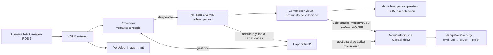

# Seguimiento visual: preview y seguimiento supervisado acotado

`hri_app` incorpora el modo YASMIN `follow_person` como **previsualización por defecto**. Adquiere `DetectPeople` mediante Capabilities2 y `YoloDetectPeople`, procesa `/hri/people` y publica diagnóstico en `/hri/follow_person/preview` (`std_msgs/msg/String`, JSON). Con activación explícita puede adquirir además `MoveVelocity` y enviar las decisiones a `NaoqiMoveVelocity`. No se añade otro proveedor.

**Sin `enable_motion:=true`, no se adquiere MoveVelocity ni se crea un publicador Twist.** La activación requiere además `confirm:=MOVER`; el intervalo de generación de comandos se acota a `duration` (0.1–300 s, predeterminado 2 s) y a `timeout` (1–300 s, predeterminado 120 s), el menor de ambos. No se modifica la vida autónoma. El autor confirmó seguimiento físico en NAO con la configuración anterior de velocidad; una configuración más rápida requiere su propia validación supervisada. Las pruebas software no la sustituyen. El modo independiente `move_velocity` conserva su límite de 5 s.

## Arquitectura de esta etapa



YASMIN organiza vínculo con el servidor, adquisición, verificación del proveedor, observación y liberación. El controlador calcula sugerencias durante el estado de observación; no necesita una transición YASMIN por imagen. La cámara y YOLO se ejecutan aparte. La visualización rqt no atraviesa el contrato común y no autoriza movimiento.

El modo usa un nodo ROS y un ejecutor de un solo hilo propios dentro del
proceso de `hri_app`, compartidos por percepción, servicios y heartbeat.
YASMIN recibe este nodo mediante `ServiceState(node=...)` y
`set_ros_loggers(node)`. No requiere otra terminal ni modifica YASMIN.

## Qué significa la sugerencia

- El centro horizontal del rectángulo orienta la sugerencia de giro. El tamaño relativo del rectángulo orienta la sugerencia de avance.
- `target_height_ratio:=0.60` significa que la altura objetivo del rectángulo ocupa el 60 % de la imagen. **No significa 60 cm ni mide distancia.** El resultado conserva `distance_m: null`.
- **Hipótesis del ensayo: una única persona en un ambiente controlado.** Se requieren tres observaciones consecutivas con una sola persona elegible. El umbral predeterminado es `minimum_confidence:=0.65`; varias detecciones que superan ese umbral son ambiguas.
- Se usa la única detección elegible sin comparar identidades, tamaños ni posiciones con la imagen anterior. No requiere tracking y no garantiza que sea la misma persona si alguien la sustituye sin un intervalo detectable. No usar esta simplificación como seguimiento entre multitudes.
- El avance conserva un máximo predeterminado de 0.03 m/s. `max_forward_speed` permite configurar un valor finito mayor que cero y hasta **0.10 m/s (10 cm/s)**. Es un máximo de la orden, no una velocidad constante ni medida; no garantiza que todo robot pueda alcanzarlo. El giro sigue limitado a 0.10 rad/s en magnitud, sin marcha atrás ni desplazamiento lateral. Solo con activación explícita se envían órdenes.
- La ganancia proporcional de avance escala con `max_forward_speed / 0.03`: para la misma caja válida y centrada, elevar el máximo de 0.03 a 0.10 aumenta la propuesta aproximadamente 3.33 veces, hasta saturar en el máximo elegido. No se cambia el tamaño visual objetivo ni las condiciones que bloquean el avance. El proveedor mantiene sus rampas de aceleración y su límite de 0.10 m/s; el adaptador de FollowPerson también verifica el máximo de la sesión.
- Cambiar de posición, tamaño de caja o identificador no genera `target_discontinuity`. Una caja grande (altura mayor al 65 % con los valores predeterminados) bloquea el avance, pero permite proponer giro si está descentrada: `preview_centering_close`. Centrada, da cero con `target_too_close_visual`.
- Una caja que toca un borde da cero en ambos ejes (`clipped_detection`), sin terminar por ese solo motivo; si vuelve a estar completa puede reanudar propuestas. No se busca fuera de la imagen. Que una caja no toque el borde no garantiza que la persona esté completa.
- Tras adquirir el objetivo, pérdida, ambigüedad o datos inválidos/antiguos dejan la propuesta en cero y terminan la prueba con fallo. No hay recuperación automática de esos fallos: revisar la causa y realizar una nueva ejecución.
- Se rechazan proveedor o `frame_id` inesperados, timestamps repetidos/no crecientes, imágenes de más de 0.75 s de antigüedad o de más de 0.10 s en el futuro. Los relojes y la latencia importan; no reducir estas validaciones para ocultar un problema de la fuente.

El `frame_id` esperado es una comprobación de consistencia, no autenticación de cámara. `robot:=nao` por sí solo no garantiza que YOLO esté recibiendo la cámara correcta. Verificar también tópico de entrada y origen de las detecciones; no mezclar NAO y Pepper en `/yolo/detections`.

El sentido del giro supone una cámara frontal alineada con la base. Esta etapa
no compensa movimientos de cabeza mediante TF ni calibra la cámara. Antes de
actuar habrá que verificar orientación y estabilidad de la cabeza; el modo no
cambia su postura ni la vida autónoma para imponerlas.

## Prueba en el computador del laboratorio

No hay evidencia física nueva asociada automáticamente a esta guía. Su ejecución con NAO valida inicialmente percepción y propuestas **con el robot quieto**, no seguimiento físico ni evitación de obstáculos.

### Preparación

En cada terminal ROS de la aplicación, cargar los tres entornos:

```bash
source /opt/ros/jazzy/setup.bash
source ~/Documents/naoqi/naoqi_ws/install/setup.bash
source ~/Documents/portable_hri_ws/install/setup.bash
```

Después de tener estos cambios disponibles localmente, compilar el paquete de aplicación (supone que sus dependencias ya fueron compiladas):

```bash
cd ~/Documents/portable_hri_ws
colcon build --packages-up-to hri_reference_app hri_naoqi_providers --symlink-install
source install/setup.bash
```

Esta guía no implica que los cambios ya hayan sido publicados en GitHub.

### Terminal 1: driver existente

Si el driver ya está activo, conservar esa terminal; no levantar otro. Si se requiere iniciarlo, confirmar IP y entorno físico seguro:

```bash
cd ~/Documents/naoqi/naoqi_ws
source /opt/ros/jazzy/setup.bash
source install/setup.bash
echo "$NAO_IP"
bash launch_driver.sh
```

**El bringup existente puede cambiar postura y estados del robot.** No confundir su comportamiento con el modo preview. Mantener supervisión y no ejecutar simultáneamente otras órdenes o aplicaciones de movimiento.

Ejecutar una sola instancia de `hri_app`/servidor Capabilities2: los recursos
`/hri/*` y la base de datos del launch siguen siendo compartidos. Esta entrega
no habilita sesiones simultáneas independientes para NAO y Pepper.

### Terminal 2: YOLO con la cámara de NAO

Cargar los tres entornos y ejecutar:

```bash
ros2 launch yolo_bringup yolo.launch.py model:=yolov8n.pt device:=cpu input_image_topic:=/nao/camera/front/image_raw imgsz_height:=320 imgsz_width:=320 use_tracking:=False use_3d:=False use_debug:=True
```

Si ya existe una instancia correcta, no duplicarla. No se necesita tracking bajo la hipótesis de una sola persona. La inferencia 320 × 320 redujo la latencia observada en el laboratorio; no cambia el campo visual ni la resolución original de la cámara (320 × 240 en ese ensayo). No garantiza ausencia de retrasos posteriores.

### Terminal 3: comprobar fuente y ejecutar la aplicación

Cargar los tres entornos. Leer **los valores reales**, sin asumir resolución de 320 × 240:

```bash
ros2 topic echo /nao/camera/front/image_raw --once --field width
ros2 topic echo /nao/camera/front/image_raw --once --field height
ros2 topic echo /nao/camera/front/image_raw --once --field header
ros2 node info /yolo/yolo_node
ros2 topic echo /yolo/detections --once --field header
```

Comprobar que YOLO se suscribe a `/nao/camera/front/image_raw` y que el `frame_id` corresponde a esa fuente. Reemplazar `ANCHO_REAL`, `ALTO_REAL` y `FRAME_REAL` por las lecturas antes de ejecutar esta plantilla:

```bash
ros2 launch hri_reference_app hri_app.launch.py robot:=nao mode:=follow_person image_width:=ANCHO_REAL image_height:=ALTO_REAL expected_frame:=FRAME_REAL minimum_confidence:=0.65 target_height_ratio:=0.60 timeout:=20.0
```

El tiempo de observación admite entre 1 y 300 segundos, con 120 s por defecto; preparación y limpieza añaden tiempo a la ejecución completa. Para una instancia YOLO con un tópico diferente, agregar `detections_topic:=/ruta/correcta/detections`; no basta con cambiar `robot`.

### Terminal 4: observar sin actuar

Cargar los tres entornos y, durante la ejecución, observar:

```bash
ros2 topic echo /hri/follow_person/preview std_msgs/msg/String --qos-reliability best_effort
```

El diagnóstico usa QoS best-effort para no bloquear la observación esperando
confirmaciones de un visor. Puede perder muestras; el JSON final resume el resultado.
En otra terminal configurada, si se desea imagen:

```bash
ros2 run rqt_image_view rqt_image_view
```

En el visor de imágenes seleccionar `/yolo/dbg_image`. Los rectángulos los dibuja YOLO y pueden incluir objetos distintos de personas; el contrato `DetectPeople` filtra personas. **No remapear ni convertir el tópico preview a `/cmd_vel`.**

Primero permanecer visible como única persona, con el cuerpo dentro del encuadre y la cabeza del robot mirando al frente. Desplazarse lentamente hacia la izquierda/derecha de la imagen: se esperan propuestas `wz_rad_s` positivas/negativas, respectivamente. Muy descentrado no propone avanzar; centrado y con caja de menos del 55 % de altura puede proponer avance. Caja grande descentrada puede dar `preview_centering_close`, sin avance. Esto no autoriza un giro físico cerca de personas.

Después comprobar por separado pérdida de objetivo y entrada de otra persona. Cada fallo que queda bloqueado requiere una nueva ejecución. Guardar el JSON final y la observación: `application_succeeded` acredita únicamente la previsualización, con `dry_run: true`, `motion_enabled: false` y `physical_success_verified: false`. El cambio no elimina los cortes por antigüedad de imagen: deben diagnosticarse si se repiten, no ocultarse aumentando el límite.

## Verificaciones de software

Desde la raíz de este repositorio, el controlador puro no requiere ROS:

```bash
python3 -m unittest discover -s tests -p test_follow_controller.py -v
```

La integración usa fuentes YOLO sintéticas, Capabilities2 y YASMIN reales. Ejecutarla solo en entorno de pruebas sin drivers, con dependencias ROS cargadas, localhost y un dominio dedicado libre (por ejemplo 181):

```bash
ROS_LOCALHOST_ONLY=1 ROS_DOMAIN_ID=181 python3 tests/unified_hri_follow_probe.py --software-only
```

El probe rechaza nodos ajenos, escribe evidencia en una carpeta temporal nueva y comprueba ausencia de publicaciones en `/hri/cmd_vel`, `/nao/cmd_vel` y `/pepper/cmd_vel`, incluidos ceros. No sustituye una validación con cámaras reales. Se usa `unittest`; no hay configuración específica de pytest ni mypy para este incremento.

Con los entornos ROS cargados, `python3 -m unittest discover -s tests -p 'test_follow_*.py' -v`
incluye también regresiones de concurrencia y validación de cabeceras del adaptador,
sin crear un grafo ROS ni conectarse al robot.

## Activación del ensayo físico supervisado

Antes de ejecutar: una sola persona, suelo plano previamente despejado, sin escaleras ni obstáculos, cabeza estable mirando al frente y cámara alineada con la base. Un supervisor debe poder utilizar la parada física independiente. No ejecutar teleoperación, otras aplicaciones de movimiento, otro servidor Capabilities2 ni otra instancia de YOLO sobre el mismo tópico. No interpretar el caminar de la persona como garantía de camino seguro.

Después de disponer de los cambios y recompilar, con driver y YOLO correctos activos, el primer ensayo de **dos segundos** usa las dimensiones y frame ya comprobados en NAO:

```bash
cd ~/Documents/portable_hri_ws
ros2 launch hri_reference_app hri_app.launch.py robot:=nao mode:=follow_person image_width:=320 image_height:=240 expected_frame:=CameraTop_optical_frame enable_motion:=true confirm:=MOVER duration:=2.0 timeout:=20.0
```

Permanecer visible y centrado antes de iniciar. Empezar quieto; no caminar hasta comprobar el sentido de respuesta. Probar avance y giro en ensayos separados. Una persona demasiado cerca o una caja recortada pueden producir solo ceros; no acercarse al robot para forzar el giro. Ante fallo, revisar y reiniciar manualmente: no se reanuda automáticamente tras perder el objetivo.

### Ajustar la velocidad sin cambiar la separación visual

Para revisar primero las propuestas con máximo de **0.10 m/s**, sin movimiento:

```bash
ros2 launch hri_reference_app hri_app.launch.py robot:=nao mode:=follow_person image_width:=320 image_height:=240 expected_frame:=CameraTop_optical_frame max_forward_speed:=0.1 timeout:=20.0
```

Con fuente, sentido de respuesta y paradas comprobados, el siguiente comando habilita un ensayo supervisado corto de dos segundos con ese máximo:

```bash
ros2 launch hri_reference_app hri_app.launch.py robot:=nao mode:=follow_person image_width:=320 image_height:=240 expected_frame:=CameraTop_optical_frame max_forward_speed:=0.1 enable_motion:=true confirm:=MOVER duration:=2.0 timeout:=20.0
```

La nueva configuración de 0.10 m/s no está validada físicamente por la corrida anterior. Es posible usar `max_forward_speed:=0.05` como incremento intermedio. No iniciar una sesión larga por el solo hecho de aceptar el parámetro: comprobar primero movimiento y parada con supervisión. La rampa del proveedor puede impedir alcanzar el máximo en un ensayo corto. Los límites de giro, pérdida de persona, antigüedad de imagen, watchdog y cancelación no cambian. Una mayor velocidad puede aumentar el recorrido antes de detenerse; el tamaño visual objetivo no equivale a una distancia de seguridad en metros.

Para la configuración solicitada de duración máxima de cinco minutos y timeout de dos minutos:

```bash
ros2 launch hri_reference_app hri_app.launch.py robot:=nao mode:=follow_person image_width:=320 image_height:=240 expected_frame:=CameraTop_optical_frame enable_motion:=true confirm:=MOVER duration:=300.0 timeout:=120.0
```

Este comando genera órdenes durante **como máximo 120 s**, no 300: aplica `min(duration, timeout)`. Para permitir cinco minutos completos, ambos deben valer `300.0`. `timeout` no es el tiempo que tolera sin ver a la persona: pérdida de objetivo, antigüedad de imagen y watchdog mantienen sus límites breves. Ampliar la duración no acredita estabilidad durante cinco minutos ni seguridad frente a obstáculos.

YASMIN adquiere DetectPeople y MoveVelocity, verifica proveedores, observa y transmite a unos 20 Hz. Al terminar o fallar, solicita cero durante 0.4 s, comprueba estado `stopped`, libera MoveVelocity y después DetectPeople. `Ctrl+C` solicita cancelación. En follow_person, un supervisor mantiene Capabilities2 disponible durante un margen máximo de 8 s para esa limpieza; al salir la aplicación solicita el cierre inmediato del servidor. El cierre del servidor escala de SIGINT a SIGTERM y SIGKILL con esperas acotadas si no responde. La caída de red/proveedor o una terminación forzada puede impedir la entrega de parada: **Ctrl+C no reemplaza una parada física**.

Resultados: `people_released` y `motion_released` informan liberación; `released` requiere ambas. `stop_acknowledged` solo confirma estado software del proveedor. `application_succeeded` significa ensayo acotado completado, incluso si todas las órdenes fueron cero. Una cancelación puede terminar como `application_failed` con mensaje `cancelled_or_ros_shutdown` y liberación correcta. `physical_success_verified` sigue en `false`: registrar por separado si NAO efectivamente siguió y se detuvo. El plazo configurado limita la generación de órdenes, no garantiza detener motores en ese plazo.

El proveedor conserva watchdog de comandos de 0.3 s y comprueba publicadores únicos, estabilidad del grafo durante 0.5 s y continuidad del GID de origen. Conflictos quedan bloqueados hasta liberar y readquirir. El descubrimiento DDS es asíncrono: no equivale a exclusión distribuida instantánea ni autenticación; otro publicador directo al driver aún podría ordenar movimiento. La caída total del proveedor o de la red no queda cubierta por su watchdog local.

Prueba software de este recorrido, **solo sin drivers y en dominio aislado**:

```bash
ROS_LOCALHOST_ONLY=1 ROS_DOMAIN_ID=182 python3 tests/unified_hri_follow_motion_probe.py --software-only
```

## Evidencia y límites

El máximo configurable de avance pasó **117/117 unitarias y 26/26 comprobaciones ROS con interfaces simuladas**, incluida saturación a 0.05/0.10 m/s, preview sin actuación y cancelación del grupo de procesos con máximo 0.10. Compilación colcon y sintaxis Python aprobaron; no hay type-checker estático ni ESLint configurados. La respuesta predeterminada coincide exactamente con la versión anterior en 2139 geometrías sintéticas. [Informe compacto generado](results/follow_person_speed_20261019.json); las trazas completas permanecen en la carpeta temporal del contenedor indicada en él. Esto no valida físicamente la nueva velocidad.

La ampliación a 300 s y corrección de Ctrl+C pasó **105/105 unitarias, 21/21 integración dos veces y 20/20 regresión preview**. La repetición comprueba cero recibido en menos de 1 s tras SIGINT al hijo, al launch y al grupo completo, sin órdenes posteriores distintas de cero, con confirmación de parada y liberación de ambas capacidades. Se verifican 120/300 s con reloj simulado; las ejecuciones ROS con configuración larga se cancelan anticipadamente. No se ha validado una sesión continua de cinco minutos, ni física ni con el backend simulado. Compilación, sintaxis y CTest 1/1 aprobaron; no hay type-checker estático ni ESLint configurados. [Evidencia y fallo de cierre anterior](results/follow_person_duration_20261019/README.md).

La integración inicial con movimiento pasó **87/87 unitarias, 18/18 integración ampliada, 20/20 regresión preview, 12/12 MoveVelocity en dos corridas, 22/22 proveedor directo y 3/3 conflictos de origen**. Colcon, sintaxis Python y CTest 1/1 aprobaron. Todo con interfaces simuladas, sin robots. Informes y fallo previo conservados en [evidencia del incremento](results/follow_person_motion_20261019/README.md).

La regresión adicional de los modos anteriores quedó 7/8 en dos repeticiones: Pepper MoveRelative informó servicio no disponible. Se conserva como hallazgo pendiente, sin modificar ese proveedor ni afirmar que toda la aplicación pasó sus regresiones. No afecta a la evidencia específica de FollowPerson, que utiliza MoveVelocity, no MoveRelative.

La simplificación previa de una sola persona pasó **57/57 pruebas unitarias/de adaptador/cierre y 20/20 de integración** en Docker Jazzy, sin hardware. El escenario nuevo verifica cambios de posición/tamaño/ID, propuesta de avance centrado y giro a ambos lados con caja grande sin avance. La integración comprobó ausencia de publicadores y mensajes de velocidad en `/hri/cmd_vel`, `/nao/cmd_vel` y `/pepper/cmd_vel`. Evidencia: [resultado de la simplificación](results/follow_person_simplified_20261019.json). Colcon, compilación de sintaxis Python y `git diff --check` aprobaron; no hay type-checker estático ni ESLint configurados para este paquete. La compilación de sintaxis no es comprobación de tipos. La repetición con cámara real se describe abajo.

La verificación software de la entrega original pasó 52 pruebas unitarias/de adaptador/cierre
y 19 de integración del nuevo modo. Las regresiones de los otros modos y un
fallo intermitente original de exclusión en MoveVelocity se detallan en
[la evidencia](results/follow_person_preview_20261019/README.md). En este incremento se incorporan las comprobaciones de fuente descritas arriba y se corrige el ejecutor del modo de velocidad, sin aumentar su watchdog. El autor aportó una corrida preview aprobada con cámara NAO (133 frames recibidos) y corridas fallidas posteriores por pérdida, caducidad y discontinuidad. Son evidencia de la versión anterior, distinta de las repeticiones simplificadas posteriores.

El autor confirmó que NAO lo siguió físicamente en una corrida con `duration:=300.0`, `timeout:=120.0` y el máximo anterior predeterminado de 0.03 m/s. El fragmento aportado muestra unos 120 s en `FOLLOW_PERSON`, `follow_trial_completed` y la transición exitosa de `STOP_MOTION_SUCCESS` a `FREE_MOTION_SUCCESS`. No incluye el JSON final: no se atribuyen a esa corrida campos de liberación ni otras métricas que no aparecen. Esta observación no valida seguimiento a 0.10 m/s, separación métrica, evitación de obstáculos ni seguimiento físico en Pepper.

El driver actual no tiene un watchdog independiente de comandos: la pérdida del proveedor o de la comunicación no garantiza una parada física. Un cero en preview no detiene ningún robot.

El autor ya repitió la simplificación con cámara real de NAO: tres previews de 20 s terminaron con `preview_completed` y `released: true`, con 117/115, 126/124 y 130/128 frames recibidos/adquiridos, respectivamente (396 muestras cada uno). La primera mostró propuestas de giro de ambos signos; la última avance entre aproximadamente 0.00518 y 0.02464 m/s, con giro cero. En las tres: `dry_run: true`, `motion_enabled: false`, `physical_success_verified: false`. Es evidencia de percepción y control propuesto, no de seguimiento físico.

La hipótesis «si pasa la persona, puede pasar el robot» no se utiliza como garantía. Una futura prueba debe limitarse a suelo plano, despejado, previamente inspeccionado, sin escaleras, con baja velocidad, supervisión y acceso a parada física. Esta etapa no estima distancia métrica, no detecta desniveles, no implementa navegación ni evita obstáculos. La selección `robot:=pepper` no acredita una prueba física de seguimiento en Pepper.
