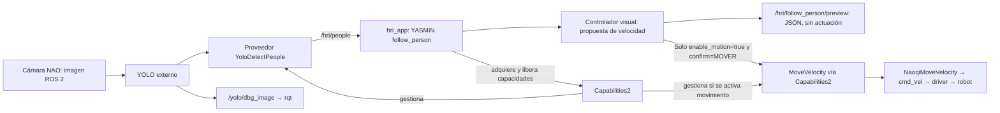

# Seguimiento visual continuo: preview y seguimiento supervisado

`hri_app` incorpora el modo YASMIN `follow_person` como **previsualización por defecto**. Adquiere `DetectPeople` mediante Capabilities2 y `YoloDetectPeople`, procesa `/hri/people` y publica diagnóstico en `/hri/follow_person/preview` (`std_msgs/msg/String`, JSON). Con activación explícita puede adquirir además `MoveVelocity` y enviar las decisiones a `NaoqiMoveVelocity`. Puede añadir `OrientCamera` y `TranscribeSpeech` opcionales bajo el mismo vínculo. Su preparación se describe en [CAMERA_AND_SPEECH.md](CAMERA_AND_SPEECH.md); los comandos básicos de esta guía conservan cámara fija y escucha desactivada.

**Sin `enable_motion:=true`, no se adquiere MoveVelocity ni se crea un publicador Twist.** La activación requiere además `confirm:=MOVER`. Desde este incremento, preview y seguimiento son continuos: no aceptan `timeout` ni `duration`; terminan por Ctrl+C o fallo. Se conservan los límites de datos frescos, confianza y salud de proveedores. No se modifica la vida autónoma. El autor confirmó seguimiento físico en NAO con la versión anterior; las pruebas software no sustituyen la validación física de este incremento. El modo independiente `move_velocity` conserva su límite de 5 s.

## Arquitectura de esta etapa



YASMIN organiza vínculo con el servidor, adquisición, verificación del proveedor, observación y liberación. El controlador calcula sugerencias durante el estado de observación; no necesita una transición YASMIN por imagen. La cámara y YOLO se ejecutan aparte. La visualización rqt no atraviesa el contrato común y no autoriza movimiento.

El modo usa un nodo ROS y un ejecutor de un solo hilo propios dentro del
proceso de `hri_app`, compartidos por percepción, servicios y heartbeat.
YASMIN recibe este nodo mediante `ServiceState(node=...)` y
`set_ros_loggers(node)`. No requiere otra terminal ni modifica YASMIN.

### Transcripción opcional durante el seguimiento

El diagrama anterior muestra el recorrido visual/base. Para añadir voz, iniciar
el worker Whisper externo con un modelo local configurado y añadir al mismo
launch de FollowPerson:

```text
transcribe_speech:=true confirm_listen:=ESCUCHAR
```

La aplicación adquiere `TranscribeSpeech` y usa español por defecto. Repite
captura → procesamiento → nueva captura mientras FollowPerson esté activo,
salvo que falle la capacidad de voz; al terminar el seguimiento termina también
la transcripción. Las ventanas de **3 s son internas**: acotan el audio de cada
solicitud, no la duración de la sesión. No pasar `record_duration` a FollowPerson;
ese argumento se conserva solo para la prueba independiente de una ventana.
`speech_language` es opcional para cambiar de idioma, innecesario para español.
Hay intervalos sin grabación mientras se procesa, no escucha ininterrumpida.
No requiere otra aplicación HRI ni usa el modo independiente de transcripción
al mismo tiempo. El proveedor predeterminado es
`hri_whisper_providers/WhisperTranscribeSpeech`.

En otra terminal, `ros2 topic echo /hri/speech/transcript --field text` muestra
los resultados después de procesar cada ventana. El diagnóstico sin texto está
en `/hri/follow_person/speech_status`. `print_transcript:=true` imprime también
en la terminal de la aplicación y puede conservar el contenido en logs; por
defecto está desactivado. No se guardan archivos de audio ni texto por defecto,
pero otros consumidores del grafo pueden recibir y grabar esos tópicos.

La escucha requiere autorización separada del movimiento y funciona también en
preview: `dry_run: true` no significa ausencia de captura si se autorizó escuchar.
Un fallo de voz deshabilita e intenta liberar solo esa capacidad; la percepción
y el movimiento conservan sus paradas. Al terminar el seguimiento, Ctrl+C o un
fallo de visión/movimiento, se solicita primero cero a la base y se libera también
la escucha. No genera respuestas ni activa `Speak` automáticamente. La captura
real, el modelo y el rendimiento de Whisper junto con YOLO siguen pendientes de
validación en el laboratorio.

## Qué significa la sugerencia

- El centro horizontal del rectángulo orienta la sugerencia de giro. El tamaño relativo del rectángulo orienta la sugerencia de avance.
- El valor predeterminado `target_height_ratio:=0.75` significa que la altura objetivo del rectángulo ocupa el 75 % de la imagen. **No significa 75 cm ni mide distancia.** Un valor mayor normalmente acerca más el robot para una misma persona y cámara. El resultado conserva `distance_m: null`.
- **Hipótesis del ensayo: una única persona en un ambiente controlado.** Se requieren tres observaciones consecutivas con una sola persona elegible. El umbral predeterminado es `minimum_confidence:=0.65`; varias detecciones que superan ese umbral son ambiguas.
- Se usa la única detección elegible sin comparar identidades, tamaños ni posiciones con la imagen anterior. No requiere tracking y no garantiza que sea la misma persona si alguien la sustituye sin un intervalo detectable. No usar esta simplificación como seguimiento entre multitudes.
- Desde el 4 de noviembre de 2026, el máximo predeterminado de avance es **0.10 m/s**, a solicitud del autor. Para conservar el máximo anterior, indicar `max_forward_speed:=0.03` explícitamente. `max_forward_speed` permite configurar un valor finito mayor que cero y hasta **0.10 m/s (10 cm/s)**. Es un máximo de la orden, no una velocidad constante ni medida; no garantiza que todo robot pueda alcanzarlo. El giro sigue limitado a 0.10 rad/s en magnitud, sin marcha atrás ni desplazamiento lateral. Solo con activación explícita se envían órdenes.
- La ganancia proporcional de avance escala con `max_forward_speed / 0.03`: para la misma caja válida y centrada, elevar el máximo de 0.03 a 0.10 aumenta la propuesta aproximadamente 3.33 veces, hasta saturar en el máximo elegido. No se cambia el tamaño visual objetivo ni las condiciones que bloquean el avance. El proveedor mantiene sus rampas de aceleración y su límite de 0.10 m/s; el adaptador de FollowPerson también verifica el máximo de la sesión.
- Cambiar de posición, tamaño de caja o identificador no genera `target_discontinuity`. Una caja grande (altura mayor al 80 % con los valores predeterminados) bloquea el avance, pero permite proponer giro si está descentrada: `preview_centering_close`. Centrada, da cero con `target_too_close_visual`.
- Una caja que toca un borde da cero en ambos ejes (`clipped_detection`), sin terminar por ese solo motivo; si vuelve a estar completa puede reanudar propuestas. Se admite únicamente error numérico de reconstrucción centro/tamaño: `dimensión × 2^-22` píxeles por eje (aproximadamente 0.000057 píxeles en altura 240). Las cajas dentro de esa tolerancia del borde, por dentro o por fuera, siguen dando cero; un desbordamiento mayor sigue siendo inválido. No se busca fuera de la imagen. Que una caja no toque el borde no garantiza que la persona esté completa.
- La ausencia de una persona elegible (`person_missing`) o varias personas elegibles (`ambiguous_people`) dejan avance y giro en cero, sin cerrar la sesión. La aplicación espera hasta disponer de una sola persona válida en tres imágenes nuevas consecutivas y de confirmación de parada. Los datos inválidos tras adquirir el objetivo y los fallos de proveedores siguen terminando la sesión.
- Se rechazan proveedor o `frame_id` inesperados, timestamps repetidos/no crecientes, imágenes de más de 0.75 s de antigüedad o de más de 0.10 s en el futuro. Los relojes y la latencia importan; no reducir estas validaciones para ocultar un problema de la fuente.

El `frame_id` esperado es una comprobación de consistencia, no autenticación de cámara. `robot:=nao` por sí solo no garantiza que YOLO esté recibiendo la cámara correcta. Verificar también tópico de entrada y origen de las detecciones; no mezclar NAO y Pepper en `/yolo/detections`.

### Esperar a una persona sin terminar la aplicación

Si no hay ninguna detección elegible o hay varias, se envía cero a la base en
cada ciclo y se conservan las capacidades. Esta espera **no tiene un plazo
máximo mientras sigan llegando imágenes frescas válidas**. No se gira buscando
a la persona ni se selecciona a una entre varias. La confianza mínima sigue
siendo 0.65 por defecto; una detección por debajo del umbral no es elegible.

Al volver a quedar una sola persona, se requieren tres imágenes consecutivas,
con sellos crecientes y posteriores al inicio de la pausa (`reacquiring_person`).
Si vuelve a faltar o hay varias, se reinicia esa cuenta. En movimiento se
requieren además al menos 0.4 s enviando cero y una confirmación `stopped`
posterior al primer cero, recibida hace menos de 0.5 s; hasta entonces se muestra
`waiting_person_stop`. Las restricciones de tamaño, centrado y recorte siguen
determinando si corresponde avanzar, girar o mantenerse quieto.

**No se reconoce identidad:** la persona con la que se reanuda puede ser otra.
`locked` conserva el significado histórico de haber adquirido alguna vez un
objetivo; no acredita identidad ni autoriza movimiento durante una pausa.
`person_wait_active`, `person_wait_reason`, `person_wait_frames` y
`person_recoveries` describen la espera; el resumen final incluye también
`person_recoveries`. Ctrl+C termina la sesión y libera las capacidades.
La voz opcional sigue su ciclo durante la espera; no se emiten nuevas órdenes
de cabeza y se siguen comprobando sus condiciones de salud.

### Recuperación de interrupciones de imagen

Desde el 4 de noviembre de 2026, superar los **0.75 s** de antigüedad de
imagen o de intervalo sin recepción inicia una pausa (`waiting_fresh_images`).
La aplicación conserva las capacidades y envía cero a la base en cada ciclo;
descarta la propuesta anterior. No aumenta el límite de frescura ni continúa
avanzando con la última orden mientras espera.

La recuperación del flujo exige **tres imágenes frescas válidas consecutivas**,
con sellos estrictamente crecientes y posteriores al inicio de la pausa.
Pueden estar vacías o contener varias personas: eso recupera el flujo, pero
mantiene la espera por una única persona descrita arriba y la base en cero.
Los mensajes antiguos en cola no cuentan. Con movimiento habilitado, exige
además al menos **0.4 s enviando cero** y una confirmación software `stopped`
posterior al primer cero y recibida hace menos de 0.5 s. Mientras falta esa
confirmación se muestra `waiting_image_recovery_stop`. No es una medida física
del frenado. Una caja recortada sigue dando cero aunque se recupere el flujo.

La espera de imágenes **ya no vence a los 3 s**: a petición del autor, la sesión
permanece abierta enviando cero hasta que se recupera el flujo o se pulsa Ctrl+C.
También puede esperar la primera imagen sin límite, siempre que el proveedor
esté disponible. Nuevos cortes reinician la cuenta de imágenes; el mismo
control se aplica al recibir una imagen para que una llegada entre ciclos no
oculte un corte. Ctrl+C, pérdida de proveedores,
timestamps repetidos/regresivos/futuros y geometría inválida conservan sus paradas.
No se emiten nuevas órdenes de cabeza durante la pausa; sus comprobaciones de
salud siguen activas si se habilitó orientación.

La hipótesis sigue siendo una única persona en un ensayo controlado: tres
observaciones no verifican identidad ni garantizan que sea la misma persona
tras el corte. `image_recovery_active`, `image_recovery_frames`,
`image_recovery_elapsed_s` e `image_recoveries` permiten observar la pausa y
las recuperaciones; el resumen final también incluye `image_recoveries`.
Este cambio permite esperar a la fuente de imágenes, pero no corrige la causa
de sus interrupciones. No se garantiza que el proceso solo termine por Ctrl+C:
los fallos técnicos críticos siguen deteniendo y liberando las capacidades.

El sentido del giro supone una cámara frontal alineada con la base. Esta etapa
no compensa movimientos de cabeza mediante TF ni calibra la cámara. Antes de
actuar habrá que verificar orientación y estabilidad de la cabeza; el modo no
cambia su postura ni la vida autónoma para imponerlas.

## Prueba en el computador del laboratorio

No hay evidencia física nueva asociada automáticamente a esta guía. Su ejecución con NAO valida inicialmente percepción y propuestas **con el robot quieto**, no seguimiento físico ni evitación de obstáculos.

### Preparación

En cada terminal ROS de la aplicación, cargar los tres entornos:

```bash
source /opt/ros/jazzy/setup.bash
source ~/Documents/naoqi/naoqi_ws/install/setup.bash
source ~/Documents/portable_hri_ws/install/setup.bash
```

Después de tener estos cambios disponibles localmente, compilar el paquete de aplicación (supone que sus dependencias ya fueron compiladas):

```bash
cd ~/Documents/portable_hri_ws
colcon build --packages-up-to hri_reference_app hri_naoqi_providers --symlink-install
source install/setup.bash
```

Esta guía no implica que los cambios ya hayan sido publicados en GitHub.

### Terminal 1: driver existente

Si el driver ya está activo, conservar esa terminal; no levantar otro. Si se requiere iniciarlo, confirmar IP y entorno físico seguro:

```bash
cd ~/Documents/naoqi/naoqi_ws
source /opt/ros/jazzy/setup.bash
source install/setup.bash
echo "$NAO_IP"
bash launch_driver.sh
```

**El bringup existente puede cambiar postura y estados del robot.** No confundir su comportamiento con el modo preview. Mantener supervisión y no ejecutar simultáneamente otras órdenes o aplicaciones de movimiento.

Ejecutar una sola instancia de `hri_app`/servidor Capabilities2: los recursos
`/hri/*` y la base de datos del launch siguen siendo compartidos. Esta entrega
no habilita sesiones simultáneas independientes para NAO y Pepper.

### Terminal 2: YOLO con la cámara de NAO

Cargar los tres entornos y ejecutar:

```bash
ros2 launch yolo_bringup yolo.launch.py model:=yolov8n.pt device:=cpu input_image_topic:=/nao/camera/front/image_raw imgsz_height:=320 imgsz_width:=320 use_tracking:=False use_3d:=False use_debug:=True
```

Si ya existe una instancia correcta, no duplicarla. No se necesita tracking bajo la hipótesis de una sola persona. La inferencia 320 × 320 redujo la latencia observada en el laboratorio; no cambia el campo visual ni la resolución original de la cámara (320 × 240 en ese ensayo). No garantiza ausencia de retrasos posteriores.

### Terminal 3: comprobar fuente y ejecutar la aplicación

Cargar los tres entornos. Leer **los valores reales**, sin asumir resolución de 320 × 240:

```bash
ros2 topic echo /nao/camera/front/image_raw --once --field width
ros2 topic echo /nao/camera/front/image_raw --once --field height
ros2 topic echo /nao/camera/front/image_raw --once --field header
ros2 node info /yolo/yolo_node
ros2 topic echo /yolo/detections --once --field header
```

Comprobar que YOLO se suscribe a `/nao/camera/front/image_raw` y que el `frame_id` corresponde a esa fuente. Reemplazar `ANCHO_REAL`, `ALTO_REAL` y `FRAME_REAL` por las lecturas antes de ejecutar esta plantilla:

```bash
ros2 launch hri_reference_app hri_app.launch.py robot:=nao mode:=follow_person image_width:=ANCHO_REAL image_height:=ALTO_REAL expected_frame:=FRAME_REAL minimum_confidence:=0.65 target_height_ratio:=0.75
```

La observación continúa hasta Ctrl+C o fallo técnico, sin vencimiento total. Las detecciones vacías pero frescas mantienen cero y permiten esperar, tanto antes como después de adquirir una persona. También se espera la primera imagen mientras el proveedor esté disponible. Pérdida, confianza insuficiente o varias personas pausan el movimiento sin cerrar la aplicación. Para una instancia YOLO con un tópico diferente, agregar `detections_topic:=/ruta/correcta/detections`; no basta con cambiar `robot`.

### Terminal 4: observar sin actuar

Cargar los tres entornos y, durante la ejecución, observar:

```bash
ros2 topic echo /hri/follow_person/preview std_msgs/msg/String --qos-reliability best_effort
```

El diagnóstico usa QoS best-effort para no bloquear la observación esperando
confirmaciones de un visor. Puede perder muestras; el JSON final resume el resultado.
`source_age_s` mide la edad del último sello aceptado; `receipt_age_s` mide
tiempo desde su recepción. `perception` conserva el frame entrante (también si
se rechazó su cabecera): sello, proveedor, frame, edad al recibir, intervalo de
recepción, dimensiones configuradas, umbral, total de personas, elegibles y
geometrías inválidas. Incluye hasta diez cajas con confianza y geometría; indica
si truncó la lista. Los valores no finitos se representan como cadenas para no
romper el diagnóstico JSON. Tras un fallo enclavado se conserva esa muestra,
sin reemplazarla por frames posteriores. Esto permite distinguir latencia,
interrupciones del flujo, varias detecciones y errores de geometría sin alterar
las paradas. No se conservan imágenes ni audio en este diagnóstico.
En otra terminal configurada, si se desea imagen:

```bash
ros2 run rqt_image_view rqt_image_view
```

En el visor de imágenes seleccionar `/yolo/dbg_image`. Los rectángulos los dibuja YOLO y pueden incluir objetos distintos de personas; el contrato `DetectPeople` filtra personas. **No remapear ni convertir el tópico preview a `/cmd_vel`.**

Primero permanecer visible como única persona, con el cuerpo dentro del encuadre y la cabeza del robot mirando al frente. Desplazarse lentamente hacia la izquierda/derecha de la imagen: se esperan propuestas `wz_rad_s` positivas/negativas, respectivamente. Muy descentrado no propone avanzar; centrado y con caja de menos del 70 % de altura puede proponer avance. Caja grande descentrada puede dar `preview_centering_close`, sin avance. Esto no autoriza un giro físico cerca de personas.

Después comprobar por separado pérdida de objetivo y entrada de otra persona: ambas deben mantener cero sin terminar, y una sola persona válida debe permitir reanudar tras la adquisición y confirmación de parada. Guardar el JSON final y la observación. Ctrl+C conserva la semántica de cancelación: puede informar `application_failed`, `cancelled_or_ros_shutdown` y `released: true`; no confundir la etiqueta con un fallo de liberación. En preview se mantienen `dry_run: true`, `motion_enabled: false` y `physical_success_verified: false`. El cambio no elimina los cortes por antigüedad de imagen: deben diagnosticarse, no ocultarse aumentando el límite.

## Verificaciones de software

El incremento del 4 de noviembre de 2026 pasó **208 pruebas unitarias** y la
compilación de `hri_reference_app`. El operador confirmó físicamente en NAO
que salir del encuadre provoca parada, volver permite reanudar y que la entrada
y salida de una segunda persona también provoca pausa y reanudación. Es una
confirmación cualitativa del operador, sin medición independiente de frenado
ni identificación personal. [Informe de espera y recuperación](results/follow_person_wait_20261104.json).

### Diagnóstico pasivo de cortes del flujo

Con driver y YOLO activos, en la terminal del laboratorio y con los mismos
overlays y dominio ROS que ellos, ejecutar desde la raíz del workspace:

```bash
python3 src/portable-hri-reference-system/tests/follow_stream_diagnostic.py --seconds 30
```

Solo observa cámara frontal NAO, `/yolo/detections` y `/hri/people`; no adquiere
capacidades ni envía órdenes. Imprime avance cada cinco segundos y guarda un
JSON en un directorio nuevo `/tmp/hri-stream-timing-*`. Conserva únicamente
tiempos, no imágenes. Sin una aplicación que active DetectPeople es normal que
`people` tenga cero muestras. Puede ejecutarse junto al preview para observar
también ese tramo. El intervalo máximo entre recepciones y la demora entre
mensajes con el mismo sello ayudan a localizar la interrupción; un observador
best-effort puede perder muestras y no demuestra por sí solo un fallo del
publicador. No aumentar el límite de frescura para ocultar estos cortes.

Desde la raíz de este repositorio, el controlador puro no requiere ROS:

```bash
python3 -m unittest discover -s tests -p test_follow_controller.py -v
```

La integración usa fuentes YOLO sintéticas, Capabilities2 y YASMIN reales. Ejecutarla solo en entorno de pruebas sin drivers, con dependencias ROS cargadas, localhost y un dominio dedicado libre (por ejemplo 181):

```bash
ROS_LOCALHOST_ONLY=1 ROS_DOMAIN_ID=181 python3 tests/unified_hri_follow_probe.py --software-only
```

El probe rechaza nodos ajenos, escribe evidencia en una carpeta temporal nueva y comprueba ausencia de publicaciones en `/hri/cmd_vel`, `/nao/cmd_vel` y `/pepper/cmd_vel`, incluidos ceros. No sustituye una validación con cámaras reales. Se usa `unittest`; no hay configuración específica de pytest ni mypy para este incremento.

Con los entornos ROS cargados, `python3 -m unittest discover -s tests -p 'test_follow_*.py' -v`
incluye también regresiones de concurrencia y validación de cabeceras del adaptador,
sin crear un grafo ROS ni conectarse al robot.

## Activación del ensayo físico supervisado

Antes de ejecutar: una sola persona, suelo plano previamente despejado, sin escaleras ni obstáculos, cabeza estable mirando al frente y cámara alineada con la base. Un supervisor debe poder utilizar la parada física independiente. No ejecutar teleoperación, otras aplicaciones de movimiento, otro servidor Capabilities2 ni otra instancia de YOLO sobre el mismo tópico. No interpretar el caminar de la persona como garantía de camino seguro.

Después de disponer de los cambios y recompilar, con driver y YOLO correctos activos, iniciar un ensayo breve y terminarlo manualmente con **Ctrl+C**. Estas son las dimensiones y frame ya comprobados en NAO:

```bash
cd ~/Documents/portable_hri_ws
ros2 launch hri_reference_app hri_app.launch.py robot:=nao mode:=follow_person image_width:=320 image_height:=240 expected_frame:=CameraTop_optical_frame enable_motion:=true confirm:=MOVER
```

Permanecer visible y centrado antes de iniciar. Empezar quieto; no caminar hasta comprobar el sentido de respuesta. Probar avance y giro en ensayos separados. Una persona demasiado cerca o una caja recortada pueden producir solo ceros; no acercarse al robot para forzar el giro. Al salir del encuadre o aparecer varias personas, comprobar parada y espera; al quedar una sola, comprobar la reanudación. Los fallos de datos, comunicación o proveedores que terminan la sesión requieren revisión y reinicio manual.

### Ajustar la velocidad sin cambiar la separación visual

Para revisar primero las propuestas con máximo de **0.10 m/s**, sin movimiento:

```bash
ros2 launch hri_reference_app hri_app.launch.py robot:=nao mode:=follow_person image_width:=320 image_height:=240 expected_frame:=CameraTop_optical_frame max_forward_speed:=0.1
```

Con fuente, sentido de respuesta y paradas comprobados, el siguiente comando habilita seguimiento supervisado con ese máximo; finalizar el ensayo con Ctrl+C:

```bash
ros2 launch hri_reference_app hri_app.launch.py robot:=nao mode:=follow_person image_width:=320 image_height:=240 expected_frame:=CameraTop_optical_frame max_forward_speed:=0.1 enable_motion:=true confirm:=MOVER
```

La nueva configuración de 0.10 m/s no está validada físicamente por la corrida anterior. Es posible usar `max_forward_speed:=0.05` como incremento intermedio. No iniciar una sesión larga por el solo hecho de aceptar el parámetro: comprobar primero movimiento y parada con supervisión. La rampa del proveedor puede impedir alcanzar el máximo en un ensayo corto. Los límites de giro, pérdida de persona, antigüedad de imagen, watchdog y cancelación no cambian. Una mayor velocidad puede aumentar el recorrido antes de detenerse; el tamaño visual objetivo no equivale a una distancia de seguridad en metros.

### Ejecución continua

FollowPerson ya no acepta `duration` ni `timeout`: retirarlos de comandos antiguos. Tanto preview como movimiento continúan hasta Ctrl+C o un fallo. Los plazos breves de comunicación, antigüedad de imagen y watchdog permanecen activos; no son límites de duración del comportamiento. La ejecución continua no acredita seguridad frente a obstáculos ni funcionamiento sin supervisión.

YASMIN adquiere DetectPeople y MoveVelocity, verifica proveedores, observa y transmite a unos 20 Hz. Al terminar o fallar, solicita cero durante 0.4 s, comprueba estado `stopped` y libera las capacidades. `Ctrl+C` solicita cancelación. En el flujo básico sin cámara ni voz, un supervisor mantiene Capabilities2 disponible durante un margen máximo de 8 s para esa limpieza; al salir la aplicación solicita el cierre inmediato del servidor. Con `orient_camera` o `transcribe_speech` habilitados, se reservan 30 s para la aplicación y 32 s para el supervisor, con escalado del servidor a SIGTERM a los 34 s; también aplica a preview con voz. Estos márgenes no son plazos de frenado físico. El cierre del servidor escala de SIGINT a SIGTERM y SIGKILL con esperas acotadas si no responde. La caída de red/proveedor o una terminación forzada puede impedir la entrega de parada: **Ctrl+C no reemplaza una parada física**.

Resultados: `people_released` y `motion_released` informan liberación; `released` requiere liberar todas las capacidades adquiridas, incluidas cámara y voz cuando se habilitan. `stop_acknowledged` solo confirma estado software del proveedor. El cierre por Ctrl+C termina como `application_failed` con mensaje `cancelled_or_ros_shutdown`: es la clasificación actual de cancelación, no implica que falló la limpieza. Comprobar los campos de parada/liberación. Ya no existe finalización exitosa por vencer el tiempo. `physical_success_verified` sigue en `false`: registrar por separado si NAO efectivamente siguió y se detuvo.

El proveedor conserva watchdog de comandos de 0.3 s y comprueba publicadores únicos, estabilidad del grafo durante 0.5 s y continuidad del GID de origen. Conflictos quedan bloqueados hasta liberar y readquirir. El descubrimiento DDS es asíncrono: no equivale a exclusión distribuida instantánea ni autenticación; otro publicador directo al driver aún podría ordenar movimiento. La caída total del proveedor o de la red no queda cubierta por su watchdog local.

Prueba software de este recorrido, **solo sin drivers y en dominio aislado**:

```bash
ROS_LOCALHOST_ONLY=1 ROS_DOMAIN_ID=182 python3 tests/unified_hri_follow_motion_probe.py --software-only
```

## Evidencia y límites

Los resultados siguientes corresponden a versiones anteriores acotadas por tiempo. Se conservan como evidencia histórica; sus argumentos temporales no son comandos vigentes para FollowPerson continuo.

El máximo configurable de avance pasó **117/117 unitarias y 26/26 comprobaciones ROS con interfaces simuladas**, incluida saturación a 0.05/0.10 m/s, preview sin actuación y cancelación del grupo de procesos con máximo 0.10. Compilación colcon y sintaxis Python aprobaron; no hay type-checker estático ni ESLint configurados. En esa verificación del 19 de octubre, con máximo predeterminado de 0.03 m/s, la respuesta coincidió con la versión anterior en 2139 geometrías sintéticas; no describe el nuevo predeterminado de 0.10 m/s. [Informe compacto generado](results/follow_person_speed_20261019.json); las trazas completas permanecen en la carpeta temporal del contenedor indicada en él. Esto no valida físicamente la nueva velocidad.

La ampliación a 300 s y corrección de Ctrl+C pasó **105/105 unitarias, 21/21 integración dos veces y 20/20 regresión preview**. La repetición comprueba cero recibido en menos de 1 s tras SIGINT al hijo, al launch y al grupo completo, sin órdenes posteriores distintas de cero, con confirmación de parada y liberación de ambas capacidades. Se verifican 120/300 s con reloj simulado; las ejecuciones ROS con configuración larga se cancelan anticipadamente. No se ha validado una sesión continua de cinco minutos, ni física ni con el backend simulado. Compilación, sintaxis y CTest 1/1 aprobaron; no hay type-checker estático ni ESLint configurados. [Evidencia y fallo de cierre anterior](results/follow_person_duration_20261019/README.md).

La integración inicial con movimiento pasó **87/87 unitarias, 18/18 integración ampliada, 20/20 regresión preview, 12/12 MoveVelocity en dos corridas, 22/22 proveedor directo y 3/3 conflictos de origen**. Colcon, sintaxis Python y CTest 1/1 aprobaron. Todo con interfaces simuladas, sin robots. Informes y fallo previo conservados en [evidencia del incremento](results/follow_person_motion_20261019/README.md).

La regresión adicional de los modos anteriores quedó 7/8 en dos repeticiones: Pepper MoveRelative informó servicio no disponible. Se conserva como hallazgo pendiente, sin modificar ese proveedor ni afirmar que toda la aplicación pasó sus regresiones. No afecta a la evidencia específica de FollowPerson, que utiliza MoveVelocity, no MoveRelative.

La simplificación previa de una sola persona pasó **57/57 pruebas unitarias/de adaptador/cierre y 20/20 de integración** en Docker Jazzy, sin hardware. El escenario nuevo verifica cambios de posición/tamaño/ID, propuesta de avance centrado y giro a ambos lados con caja grande sin avance. La integración comprobó ausencia de publicadores y mensajes de velocidad en `/hri/cmd_vel`, `/nao/cmd_vel` y `/pepper/cmd_vel`. Evidencia: [resultado de la simplificación](results/follow_person_simplified_20261019.json). Colcon, compilación de sintaxis Python y `git diff --check` aprobaron; no hay type-checker estático ni ESLint configurados para este paquete. La compilación de sintaxis no es comprobación de tipos. La repetición con cámara real se describe abajo.

La verificación software de la entrega original pasó 52 pruebas unitarias/de adaptador/cierre
y 19 de integración del nuevo modo. Las regresiones de los otros modos y un
fallo intermitente original de exclusión en MoveVelocity se detallan en
[la evidencia](results/follow_person_preview_20261019/README.md). En este incremento se incorporan las comprobaciones de fuente descritas arriba y se corrige el ejecutor del modo de velocidad, sin aumentar su watchdog. El autor aportó una corrida preview aprobada con cámara NAO (133 frames recibidos) y corridas fallidas posteriores por pérdida, caducidad y discontinuidad. Son evidencia de la versión anterior, distinta de las repeticiones simplificadas posteriores.

El autor confirmó que NAO lo siguió físicamente en una corrida con `duration:=300.0`, `timeout:=120.0` y el máximo anterior predeterminado de 0.03 m/s. El fragmento aportado muestra unos 120 s en `FOLLOW_PERSON`, `follow_trial_completed` y la transición exitosa de `STOP_MOTION_SUCCESS` a `FREE_MOTION_SUCCESS`. No incluye el JSON final: no se atribuyen a esa corrida campos de liberación ni otras métricas que no aparecen. Esta observación no valida seguimiento a 0.10 m/s, separación métrica, evitación de obstáculos ni seguimiento físico en Pepper.

El driver actual no tiene un watchdog independiente de comandos: la pérdida del proveedor o de la comunicación no garantiza una parada física. Un cero en preview no detiene ningún robot.

El autor ya repitió la simplificación con cámara real de NAO: tres previews de 20 s terminaron con `preview_completed` y `released: true`, con 117/115, 126/124 y 130/128 frames recibidos/adquiridos, respectivamente (396 muestras cada uno). La primera mostró propuestas de giro de ambos signos; la última avance entre aproximadamente 0.00518 y 0.02464 m/s, con giro cero. En las tres: `dry_run: true`, `motion_enabled: false`, `physical_success_verified: false`. Es evidencia de percepción y control propuesto, no de seguimiento físico.

La hipótesis «si pasa la persona, puede pasar el robot» no se utiliza como garantía. Una futura prueba debe limitarse a suelo plano, despejado, previamente inspeccionado, sin escaleras, con baja velocidad, supervisión y acceso a parada física. Esta etapa no estima distancia métrica, no detecta desniveles, no implementa navegación ni evita obstáculos. La selección `robot:=pepper` no acredita una prueba física de seguimiento en Pepper.
