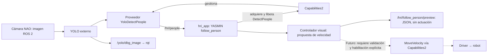

# Seguimiento visual: primera etapa sin movimiento

`hri_app` incorpora el modo YASMIN `follow_person` como **previsualización**, no como seguimiento físico habilitado. Adquiere `DetectPeople` mediante Capabilities2 y el proveedor existente `YoloDetectPeople`, procesa `/hri/people` y publica sugerencias numéricas en `/hri/follow_person/preview` (`std_msgs/msg/String`, contenido JSON).

No se crea un proveedor nuevo. **No se adquiere `MoveVelocity`, no se publican mensajes `Twist` y no se llaman servicios de movimiento.** Tampoco se modifica la vida autónoma. No existe un argumento que active movimiento en este modo: `motion_enabled: false` es una declaración del resultado, no un interruptor configurable.

## Arquitectura de esta etapa



YASMIN organiza vínculo con el servidor, adquisición, verificación del proveedor, observación y liberación. El controlador calcula sugerencias durante el estado de observación; no necesita una transición YASMIN por imagen. La cámara y YOLO se ejecutan aparte. La visualización rqt no atraviesa el contrato común y no autoriza movimiento.

El modo usa un nodo ROS y un ejecutor de un solo hilo propios dentro del
proceso de `hri_app`, compartidos por percepción, servicios y heartbeat.
YASMIN recibe este nodo mediante `ServiceState(node=...)` y
`set_ros_loggers(node)`. No requiere otra terminal ni modifica YASMIN.

## Qué significa la sugerencia

- El centro horizontal del rectángulo orienta la sugerencia de giro. El tamaño relativo del rectángulo orienta la sugerencia de avance.
- `target_height_ratio:=0.60` significa que la altura objetivo del rectángulo ocupa el 60 % de la imagen. **No significa 60 cm ni mide distancia.** El resultado conserva `distance_m: null`.
- **Hipótesis del ensayo: una única persona en un ambiente controlado.** Se requieren tres observaciones consecutivas con una sola persona elegible. El umbral predeterminado es `minimum_confidence:=0.65`; varias detecciones que superan ese umbral son ambiguas.
- Se usa la única detección elegible sin comparar identidades, tamaños ni posiciones con la imagen anterior. No requiere tracking y no garantiza que sea la misma persona si alguien la sustituye sin un intervalo detectable. No usar esta simplificación como seguimiento entre multitudes.
- Las sugerencias están limitadas a avance de 0.03 m/s y giro de 0.10 rad/s en magnitud; no hay marcha atrás ni desplazamiento lateral. Son números diagnósticos, no velocidades ejecutadas.
- Cambiar de posición, tamaño de caja o identificador no genera `target_discontinuity`. Una caja grande (altura mayor al 65 % con los valores predeterminados) bloquea el avance, pero permite proponer giro si está descentrada: `preview_centering_close`. Centrada, da cero con `target_too_close_visual`. No se aumentaron las velocidades.
- Una caja que toca un borde da cero en ambos ejes (`clipped_detection`), sin terminar por ese solo motivo; si vuelve a estar completa puede reanudar propuestas. No se busca fuera de la imagen. Que una caja no toque el borde no garantiza que la persona esté completa.
- Tras adquirir el objetivo, pérdida, ambigüedad o datos inválidos/antiguos dejan la propuesta en cero y terminan la prueba con fallo. No hay recuperación automática de esos fallos: revisar la causa y realizar una nueva ejecución.
- Se rechazan proveedor o `frame_id` inesperados, timestamps repetidos/no crecientes, imágenes de más de 0.75 s de antigüedad o de más de 0.10 s en el futuro. Los relojes y la latencia importan; no reducir estas validaciones para ocultar un problema de la fuente.

El `frame_id` esperado es una comprobación de consistencia, no autenticación de cámara. `robot:=nao` por sí solo no garantiza que YOLO esté recibiendo la cámara correcta. Verificar también tópico de entrada y origen de las detecciones; no mezclar NAO y Pepper en `/yolo/detections`.

El sentido del giro supone una cámara frontal alineada con la base. Esta etapa
no compensa movimientos de cabeza mediante TF ni calibra la cámara. Antes de
actuar habrá que verificar orientación y estabilidad de la cabeza; el modo no
cambia su postura ni la vida autónoma para imponerlas.

## Prueba en el computador del laboratorio

No hay evidencia física nueva asociada automáticamente a esta guía. Su ejecución con NAO valida inicialmente percepción y propuestas **con el robot quieto**, no seguimiento físico ni evitación de obstáculos.

### Preparación

En cada terminal ROS de la aplicación, cargar los tres entornos:

```bash
source /opt/ros/jazzy/setup.bash
source ~/Documents/naoqi/naoqi_ws/install/setup.bash
source ~/Documents/portable_hri_ws/install/setup.bash
```

Después de tener estos cambios disponibles localmente, compilar el paquete de aplicación (supone que sus dependencias ya fueron compiladas):

```bash
cd ~/Documents/portable_hri_ws
colcon build --packages-select hri_reference_app --symlink-install
source install/setup.bash
```

Esta guía no implica que los cambios ya hayan sido publicados en GitHub.

### Terminal 1: driver existente

Si el driver ya está activo, conservar esa terminal; no levantar otro. Si se requiere iniciarlo, confirmar IP y entorno físico seguro:

```bash
cd ~/Documents/naoqi/naoqi_ws
source /opt/ros/jazzy/setup.bash
source install/setup.bash
echo "$NAO_IP"
bash launch_driver.sh
```

**El bringup existente puede cambiar postura y estados del robot.** No confundir su comportamiento con el modo preview. Mantener supervisión y no ejecutar simultáneamente otras órdenes o aplicaciones de movimiento.

Ejecutar una sola instancia de `hri_app`/servidor Capabilities2: los recursos
`/hri/*` y la base de datos del launch siguen siendo compartidos. Esta entrega
no habilita sesiones simultáneas independientes para NAO y Pepper.

### Terminal 2: YOLO con la cámara de NAO

Cargar los tres entornos y ejecutar:

```bash
ros2 launch yolo_bringup yolo.launch.py model:=yolov8n.pt device:=cpu input_image_topic:=/nao/camera/front/image_raw imgsz_height:=320 imgsz_width:=320 use_tracking:=False use_3d:=False use_debug:=True
```

Si ya existe una instancia correcta, no duplicarla. No se necesita tracking bajo la hipótesis de una sola persona. La inferencia 320 × 320 redujo la latencia observada en el laboratorio; no cambia el campo visual ni la resolución original de la cámara (320 × 240 en ese ensayo). No garantiza ausencia de retrasos posteriores.

### Terminal 3: comprobar fuente y ejecutar la aplicación

Cargar los tres entornos. Leer **los valores reales**, sin asumir resolución de 320 × 240:

```bash
ros2 topic echo /nao/camera/front/image_raw --once --field width
ros2 topic echo /nao/camera/front/image_raw --once --field height
ros2 topic echo /nao/camera/front/image_raw --once --field header
ros2 node info /yolo/yolo_node
ros2 topic echo /yolo/detections --once --field header
```

Comprobar que YOLO se suscribe a `/nao/camera/front/image_raw` y que el `frame_id` corresponde a esa fuente. Reemplazar `ANCHO_REAL`, `ALTO_REAL` y `FRAME_REAL` por las lecturas antes de ejecutar esta plantilla:

```bash
ros2 launch hri_reference_app hri_app.launch.py robot:=nao mode:=follow_person image_width:=ANCHO_REAL image_height:=ALTO_REAL expected_frame:=FRAME_REAL minimum_confidence:=0.65 target_height_ratio:=0.60 timeout:=20.0
```

El tiempo de observación admite entre 1 y 60 segundos; preparación y limpieza añaden tiempo a la ejecución completa. Para una instancia YOLO con un tópico diferente, agregar `detections_topic:=/ruta/correcta/detections`; no basta con cambiar `robot`.

### Terminal 4: observar sin actuar

Cargar los tres entornos y, durante la ejecución, observar:

```bash
ros2 topic echo /hri/follow_person/preview std_msgs/msg/String --qos-reliability best_effort
```

El diagnóstico usa QoS best-effort para no bloquear la observación esperando
confirmaciones de un visor. Puede perder muestras; el JSON final resume el resultado.
En otra terminal configurada, si se desea imagen:

```bash
ros2 run rqt_image_view rqt_image_view
```

En el visor de imágenes seleccionar `/yolo/dbg_image`. Los rectángulos los dibuja YOLO y pueden incluir objetos distintos de personas; el contrato `DetectPeople` filtra personas. **No remapear ni convertir el tópico preview a `/cmd_vel`.**

Primero permanecer visible como única persona, con el cuerpo dentro del encuadre y la cabeza del robot mirando al frente. Desplazarse lentamente hacia la izquierda/derecha de la imagen: se esperan propuestas `wz_rad_s` positivas/negativas, respectivamente. Muy descentrado no propone avanzar; centrado y con caja de menos del 55 % de altura puede proponer avance. Caja grande descentrada puede dar `preview_centering_close`, sin avance. Esto no autoriza un giro físico cerca de personas.

Después comprobar por separado pérdida de objetivo y entrada de otra persona. Cada fallo que queda bloqueado requiere una nueva ejecución. Guardar el JSON final y la observación: `application_succeeded` acredita únicamente la previsualización, con `dry_run: true`, `motion_enabled: false` y `physical_success_verified: false`. El cambio no elimina los cortes por antigüedad de imagen: deben diagnosticarse si se repiten, no ocultarse aumentando el límite.

## Verificaciones de software

Desde la raíz de este repositorio, el controlador puro no requiere ROS:

```bash
python3 -m unittest discover -s tests -p test_follow_controller.py -v
```

La integración usa fuentes YOLO sintéticas, Capabilities2 y YASMIN reales. Ejecutarla solo en entorno de pruebas sin drivers, con dependencias ROS cargadas, localhost y un dominio dedicado libre (por ejemplo 181):

```bash
ROS_LOCALHOST_ONLY=1 ROS_DOMAIN_ID=181 python3 tests/unified_hri_follow_probe.py --software-only
```

El probe rechaza nodos ajenos, escribe evidencia en una carpeta temporal nueva y comprueba ausencia de publicaciones en `/hri/cmd_vel`, `/nao/cmd_vel` y `/pepper/cmd_vel`, incluidos ceros. No sustituye una validación con cámaras reales. Se usa `unittest`; no hay configuración específica de pytest ni mypy para este incremento.

Con los entornos ROS cargados, `python3 -m unittest discover -s tests -p 'test_follow_*.py' -v`
incluye también regresiones de concurrencia y validación de cabeceras del adaptador,
sin crear un grafo ROS ni conectarse al robot.

## Siguiente etapa y límites

La simplificación de una sola persona pasó **57/57 pruebas unitarias/de adaptador/cierre y 20/20 de integración** en Docker Jazzy, sin hardware. El escenario nuevo verifica cambios de posición/tamaño/ID, propuesta de avance centrado y giro a ambos lados con caja grande sin avance. La integración comprobó ausencia de publicadores y mensajes de velocidad en `/hri/cmd_vel`, `/nao/cmd_vel` y `/pepper/cmd_vel`. Evidencia: [resultado de la simplificación](results/follow_person_simplified_20261019.json). Colcon, compilación de sintaxis Python y `git diff --check` aprobaron; no hay type-checker estático ni ESLint configurados para este paquete. La compilación de sintaxis no es comprobación de tipos. La repetición de estos cambios con cámara real sigue pendiente.

La verificación software de la entrega original pasó 52 pruebas unitarias/de adaptador/cierre
y 19 de integración del nuevo modo. Las regresiones de los otros modos y un
fallo intermitente pendiente de exclusión en MoveVelocity se detallan en
[la evidencia](results/follow_person_preview_20261019/README.md). No interpretar
la repetición aprobada de ese caso como fallo corregido; revisarlo antes de
habilitar seguimiento físico. El autor aportó una corrida preview aprobada con cámara NAO (133 frames recibidos) y corridas fallidas posteriores por pérdida, caducidad y discontinuidad. Son evidencia de la versión anterior, no aprobación de la simplificación actual ni seguimiento físico. La nueva lógica debe repetirse en el laboratorio.

La solicitud de seguimiento físico queda como siguiente etapa explícita, **no habilitada en esta entrega**. Antes de conectar el controlador a `MoveVelocity`, validar la propuesta con imagen real, tratamiento de pérdidas, parada independiente y condiciones del ensayo. El driver actual no tiene un watchdog independiente de comandos: la pérdida del proveedor o de la comunicación no garantiza una parada física. Un cero en preview no detiene ningún robot.

La hipótesis «si pasa la persona, puede pasar el robot» no se utiliza como garantía. Una futura prueba debe limitarse a suelo plano, despejado, previamente inspeccionado, sin escaleras, con baja velocidad, supervisión y acceso a parada física. Esta etapa no estima distancia métrica, no detecta desniveles, no implementa navegación ni evita obstáculos. La selección `robot:=pepper` no acredita una prueba física de seguimiento en Pepper.
