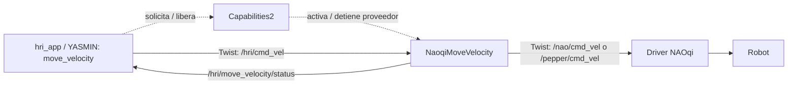

# MoveVelocity: velocidad continua y ensayo supervisado

Este incremento añade un cuarto modo independiente de `hri_app`. No sustituye
`MoveRelative`, no implementa seguimiento de personas ni detección de obstáculos,
y no modifica la vida autónoma. La validación física en NAO y Pepper está pendiente.

## Arquitectura



Capabilities2 gestiona el ciclo de vida; las órdenes no atraviesan un servicio
de Capabilities2 en cada ciclo. La aplicación publica un flujo de velocidades
y el proveedor adapta su destino. Una futura conducta de seguimiento podrá
calcular velocidades a partir de percepción reciente; no está implementada aquí.

| Campo Twist | Significado | Límite inicial absoluto |
| --- | --- | --- |
| `linear.x` | avance/retroceso, m/s | 0.10 |
| `linear.y` | lateral, m/s | 0.05 |
| `angular.z` | giro, rad/s | 0.20 |

Marco corporal actual: X adelante, Y izquierda, Z arriba. Los otros componentes
deben ser cero. Estas cantidades no son distancias. Las rampas y las dinámicas
del robot hacen que velocidad por duración no sea una garantía de distancia.

## Protecciones y límites

- Publicación de salida a 20 Hz y watchdog de entrada de 300 ms, usando reloj monotónico.
- Límites conservadores; órdenes no finitas, fuera de rango o con ejes no soportados solicitan cero.
- Rampa de aceleración para iniciar/cambiar velocidad; parada por cero o fallo sin rampa.
- Órdenes cero al finalizar y liberar; estado periódico permite al cliente detectar ausencia del proveedor.
- Exclusión local entre los proveedores propios de velocidad y movimiento relativo para el mismo robot.
- Ensayo YASMIN de duración acotada, con confirmación `MOVER` y un solo robot/controlador activo.

**Limitaciones que no deben confundirse con garantías de seguridad:**

1. El watchdog está en el proveedor. Si muere ese proceso, el driver o la red,
   no puede garantizar que el robot reciba cero. El callback `cmd_vel` del driver
   local no implementa su propio watchdog. Se requiere supervisión y acceso a
   la parada física; para uso autónomo hace falta una protección adicional aguas abajo.
2. Un suscriptor DDS no prueba conexión NAOqi ni movimiento real. `stopped`
   confirma orden cero del proveedor, no una parada física medida.
3. `Twist` no lleva marca temporal. La caducidad se mide desde recepción, y el
   cliente debe dejar de producir órdenes cuando caduquen sus datos de percepción.
4. La exclusión local no bloquea teleoperadores externos, publicadores directos
   del driver, procesos en otros computadores/contenedores o usuarios distintos.
5. No hay detección de obstáculos en esta capacidad. Nunca ensayar cerca de
   personas, bordes, escaleras u objetos; no deshabilitar protecciones del robot.
6. La versión de Capabilities2 usada puede conservar en su catálogo un runner
   cuya activación falló (por ejemplo, por exclusión de movimiento). No basta
   con `get_running_capabilities`: el cliente exige también endpoints y estado
   reciente del proveedor. El bloqueo evita emitir órdenes, pero no corrige
   ese defecto de reporte de Capabilities2. Tras el fallo hay que liberar la
   entrada fallida antes de reintentar; no asumir que está operativa por aparecer
   en el catálogo. El código externo no se ha modificado.

## Preparar el computador del laboratorio

Estos pasos requieren que **los tres repositorios contengan este incremento**.
La implementación local no equivale a su publicación en GitHub. Una vez
distribuida, actualizar cada repositorio, no la raíz del workspace:

```bash
cd ~/Documents/portable_hri_ws/src/portable-hri-interfaces
git pull --ff-only
cd ../portable-hri-providers
git pull --ff-only
cd ../portable-hri-reference-system
git pull --ff-only
cd ~/Documents/portable_hri_ws
source /opt/ros/jazzy/setup.bash
source ~/Documents/naoqi/naoqi_ws/install/setup.bash
sudo apt-get update
sudo apt-get install ros-jazzy-bondpy
colcon build --packages-up-to hri_reference_app --symlink-install
source install/setup.bash
python3 -c 'import yasmin, yasmin_ros, bondpy'
```

No recompilar ni instalar nada mientras haya una orden de movimiento en ejecución.
Si una terminal nueva no descubre paquetes, cargar los tres `setup.bash` anteriores.

## Primera prueba NAO (pendiente)

Antes de arrancar, despejar el entorno y asegurar supervisión directa. El bringup
existente puede ordenar postura y cambiar estados: no es solo descubrimiento ROS.
En la terminal del driver:

```bash
cd ~/Documents/naoqi/naoqi_ws
bash launch_driver.sh
```

Esperar a que termine el arranque. En otra terminal, después de cargar el entorno:

```bash
ros2 topic info /nao/cmd_vel -v
ros2 service list | grep /nao/move_to
```

Debe aparecer el suscriptor `naoqi_driver`. No debe haber otro controlador
enviando movimiento. Para el primer ensayo usar solo avance lento y corto:

```bash
ros2 launch hri_reference_app hri_app.launch.py robot:=nao mode:=move_velocity vx:=0.03 vy:=0.0 wz:=0.0 duration:=2.0 confirm:=MOVER
```

Observar si se mueve y **se detiene**. No enviar una segunda orden si el estado
físico es incierto. `Ctrl+C` intenta limpieza, pero no reemplaza la parada física.
Guardar el JSON, el log del driver y la confirmación del observador. Un resultado
de aplicación satisfactorio demuestra el envío, la parada solicitada y liberación;
no certifica distancia recorrida ni seguridad física.

Para Pepper el selector será `robot:=pepper`, después de verificar su driver,
estado mecánico y espacio libre. La portabilidad física de este incremento aún
no se ha comprobado en ninguno de los dos robots.

## Verificación sin robot

Los probes nuevos exigen `--software-only`, descubrimiento localhost y un
dominio de pruebas >=100. No ejecutarlos en el dominio del robot ni junto a un
driver físico. Usan suscriptores simulados, no NAOqi.

```bash
ROS_LOCALHOST_ONLY=1 ROS_DOMAIN_ID=182 python3 src/portable-hri-reference-system/tests/capabilities_naoqi_move_velocity_probe.py --software-only
ROS_LOCALHOST_ONLY=1 ROS_DOMAIN_ID=183 python3 src/portable-hri-reference-system/tests/unified_hri_velocity_probe.py --software-only
```

Resultado del 14 de octubre de 2026, Docker Linux ARM64 / ROS 2 Jazzy:

- Proveedor: **22/22** comprobaciones aprobadas, incluidas caducidad, valores
  inválidos, pérdida/reconexión del suscriptor y exclusión operativa en ambos sentidos.
- Aplicación: **11/11**, incluidos NAO/Pepper simulados, rechazo de argumentos,
  SIGINT cooperativo del proceso de aplicación, publicador competidor y backend ausente.
- Regresión de los tres modos anteriores: **8/8**.
- CTest `motion_lease`: **1/1**, bloqueo del mismo proceso y entre procesos.
- Compilación C++ y sintaxis Python correctas; YAML/XML válidos. No hay
  type-checker Python ni ESLint configurados; `compileall` no sustituye un
  análisis de tipos Python. Dockerfiles incluyen bondpy; en esta sesión se
  instaló en el contenedor existente, no se reconstruyó la imagen completa.

Evidencia: [resultados conservados](results/move_velocity_software_20261014/README.md).
El defecto de catálogo de Capabilities2 se conserva como limitación explícita,
no se cuenta como corregido. El heartbeat usa [bondpy](https://index.ros.org/p/bondpy/),
no se deshabilita el mecanismo de supervisión de Capabilities2.

La aplicación mantiene una sola sesión activa: los tópicos `/hri/*`, servidor
y SQLite siguen siendo compartidos. No ejecutar dos `hri_app` simultáneos.
`ros2 launch` puede devolver código cero aunque el proceso de aplicación
publique `application_failed`; evaluar el JSON y el log, no solo `$?` del launch.
No usar las pruebas antiguas de `MoveRelative` como evidencia física de `MoveVelocity`.
